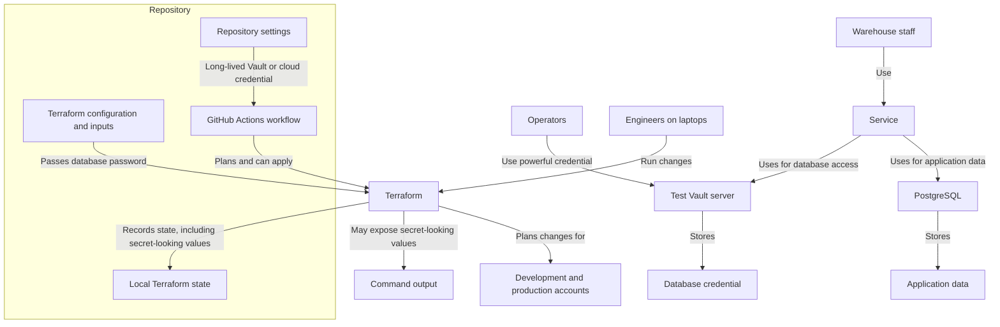

# Capstone — Mossvale Supply written scenarios

Prerequisites: [Vault 04 — PKI and transit](slices/vault/04-pki-transit.md),
[Terraform + Vault 02 — CI/CD with no stored secrets](slices/terraform-vault/02-ci.md),
and [Adversary 01 — Advisory: licensing and Enterprise](slices/adversary/01-advisory.md).

## Why

The capstone asks you to advise one fictional customer across Terraform,
Vault, CI, and product decisions. Start with written diagnoses. Do not build
anything until you have recorded what you think is happening, what you
recommend, the order of work, and why.

The later build stage uses a matching synthetic Mossvale Supply environment.
These scenarios describe its problems without giving you the fixes.

Save your answers in `submissions/capstone/answers.md`. Keep the same
per-slice layout used elsewhere in this guide:

```text
submissions/
  capstone/
    code/
    evidence/
    answers.md
```

The `code/` folder belongs to the later build stage. Do not add the synthetic
environment or build-stage solutions while completing these written scenarios.

## Concepts

- Terraform state and ownership
- Terraform structure and interfaces
- Vault operation and recovery
- secret handling and short-lived access
- CI trust and review boundaries
- licensing, hosting, and Enterprise decisions
- diagnosis, evidence, sequencing, and risk

The map shows the written scenarios, not a proposed fix. The service is part
of the customer scenario, not a container in the supplied environment.



Read the map from the people at the top down to the systems they use. Two
paths run Terraform: engineers on laptops and the GitHub Actions workflow. The
repository box groups the configuration, state, settings, and workflow that
both paths share.

## Tasks

### Task 01 — Diagnose Terraform ownership and structure

Mossvale Supply has a small platform team and separate development and
production accounts. Both environments were first created from one Terraform
directory. The state file is now stored beside the configuration in the
repository, and two engineers sometimes run changes from their laptops.

After a refactor, a plan proposes replacing resources that the team believes
already exist. A second engineer reports that a change made for development
also appears in the production plan. The repository has repeated resource
blocks with slightly different names, and a new team member cannot tell which
values are inputs, which are derived values, or which resources belong to
each environment. The team has not yet destroyed anything, but it cannot
explain which state owns each resource.

Write a diagnosis and recommendation for Mossvale Supply. State the order in
which the team should investigate and change the setup, and give the reason
for each step. Identify the checks that should happen before and after each
state or configuration change.

#### Done when

- The answer separates symptoms, likely causes, and facts that still need
  verification. A learner-drawn diagram in `answers.md` may support this
  distinction.
- The recommendation addresses both state ownership and configuration
  structure without treating a refactor as proof that resources are safe.
- The work is ordered to preserve resource ownership and avoid accidental
  replacement or cross-environment changes.
- Each major step has a reason tied to risk, reviewability, or team
  operation.
- The answer names evidence that would confirm the diagnosis and a safe
  stopping point if the evidence disagrees.

### Task 02 — Diagnose Vault operation and secret exposure

Mossvale Supply runs a test Vault server for a service that needs database
access. The server was started for convenience and loses its data when the
container is replaced. Operators use one powerful credential for setup and
routine checks. A database password is also passed through Terraform, and
the team has found secret-looking values in local state and command output.

The service still works, but nobody can show who changed a secret, how the
server would be recovered after a restart, or how access would be removed
when a job ends. The team wants a diagnosis that works for the local training
environment and clearly identifies which conclusions would require a real
client Vault.

Write a diagnosis and recommendation for Mossvale Supply. State the order of
operational, access, and secret-handling work, and explain why that order
reduces risk. Distinguish temporary test material from credentials that must
not become repository or routine-operator secrets.

#### Done when

- The answer distinguishes availability, seal or recovery, authentication,
  auditability, and secret-lifecycle symptoms. A learner-drawn diagram in
  `answers.md` may support these distinctions.
- The recommendation separates bootstrap access from routine access and
  explains the boundary between Vault and Terraform state.
- The order includes a way to validate recovery and access removal without
  destroying the only working test setup.
- The answer identifies what evidence may be recorded safely and what must
  be redacted or kept outside the repository.
- The answer states which local observations do not prove production Vault
  behavior and what the client would still need to confirm.

### Task 03 — Diagnose CI trust and review boundaries

Mossvale Supply has a public Terraform repository. A pull request workflow
formats and plans changes, but a later step can also apply them. The same
workflow uses a long-lived Vault or cloud credential stored in repository
settings. Its permissions are broad because the original author wanted to
avoid authentication failures.

A recent log contains a Terraform diagnostic with more detail than expected.
The team cannot show that apply waits for a human review, that a job from an
unexpected branch is rejected, or that a failed authentication attempt could
not read the test secret. The workflow uses third-party actions, but the
review record does not show why their selected versions are trusted.

Write a diagnosis and recommendation for Mossvale Supply. State the order of
changes to planning, authentication, permissions, approval, and log review.
Give reasons for the order and identify tests that demonstrate both the
allowed path and the rejected path.

#### Done when

- The answer identifies separate trust boundaries for pull requests, apply,
  repository identity, Vault access, and workflow logs. A learner-drawn
  diagram in `answers.md` may support this identification.
- The recommendation removes the need for a long-lived routine credential
  without assuming that masking a value is access control.
- The order keeps a reviewable plan and a recoverable test path while CI
  changes are made.
- The answer specifies least-privilege and branch or repository restriction
  checks, including what a rejected job must not receive.
- The answer names evidence for action pinning, permissions, approval, and
  redacted logs without asking the learner to expose token contents.

### Task 04 — Diagnose licensing and Enterprise fit

Mossvale Supply asks whether it should buy Terraform or Vault Enterprise
before expanding from one platform team to several. The company mentions
team separation, disaster recovery, policy guardrails, hardware-backed key
protection, support, and a hosted option, but has not stated which are
mandatory controls, how many operators it will staff, or what downtime and
recovery targets it needs.

The current local training setup uses Community-compatible components. The
customer has received conflicting informal advice about which features
require a paid product and how much operation would cost. Some advice is
based on old web pages, and no one has recorded the source date or separated
licence terms from product capability and support.

Write a diagnosis and recommendation for Mossvale Supply. State the order of
questions, evidence gathering, source checking, and decision review. Explain
why a feature request alone is not enough to recommend Enterprise or a
hosted service, and identify what the local build can and cannot demonstrate.

#### Done when

- The answer separates client requirements from product capabilities,
  licence terms, hosting choices, support, and operating cost. A learner-drawn
  diagram in `answers.md` may support these distinctions.
- The recommendation treats namespaces, replication, policy guardrails, and
  hardware-backed protection as questions to verify rather than automatic
  reasons to buy.
- The order gathers current official sources and client evidence before
  making a commercial recommendation.
- Each major recommendation names the evidence or owner needed to confirm
  fit, cost, migration impact, and ongoing operations.
- The answer preserves a Community-compatible local build and records which
  Enterprise or hosted claims remain untested or uncertain.

### Stage 2 — Build

Answer the Explain questions at the end of this page before you start stage 2.
Now build the recommendations you wrote in stage 1. Work only in a copy of
the synthetic customer environment:

```text
customers/mossvale-supply/                 immutable baseline
submissions/capstone/code/mossvale-supply/ your working copy
```

Use the customer start and reset tasks in `customers/mossvale-supply/README.md`.
Never edit the baseline. Keep authored task artifacts in
`submissions/capstone/code/`. Keep runtime captures in
`submissions/capstone/evidence/`, with task numbers in their filenames.
Follow the [evidence format](grading.md#evidence-format).
Keep your build-stage answers in `submissions/capstone/answers.md`. Give each
task Explain answer a heading that matches its question, such as
`## Task 05 Explain 1`.

Record before and after results. Redact passwords, tokens, and other secret
values. If a check fails, keep the failure and explain what it means. Do not
claim that a local result proves behavior in a hosted service or Enterprise
product.

### Task 05 — Build the Terraform recommendation

Implement the recommendation you wrote for Task 01 in your working copy.
Your change must make ownership and environment boundaries clear without
assuming that a refactor makes existing resources safe.

#### Constraints

- Preserve the immutable baseline and work only in the working copy.
- Keep development and production distinguishable in configuration and state.
- Do not add real credentials or secret values to the repository.
- Stop before any destructive action if your evidence does not explain the
  proposed ownership or replacement.

#### Done when

- Before and after plan output shows how your change affects each environment.
- State and configuration evidence identifies which setup owns each resource.
- The configuration makes inputs, derived values, and environment-specific
  resources easy to review.
- A check shows that a development change does not silently alter production.
- Your evidence records any remaining uncertainty and the safe stopping point.

#### Evidence to produce

Keep final configuration and task notes in `code/`. Capture commands,
redacted plan output, relevant state checks, and before-and-after runtime
results in `evidence/` files named with the `task-05-` prefix.

#### Explain

Answer from your own change and evidence. Point to evidence by filename.

##### Task 05 Explain 1

**Situation:** A Mossvale engineer reads your change but has not read your Task 01 diagnosis. They want to know why each part of the change exists.

**Question:** What did you change, and which step of your Task 01 recommendation does each change carry out?

**A solid answer covers:**

- Each configuration, structure, or state change you made.
- The Task 01 step or cause that each change addresses.
- Any Task 01 step you did not build.

##### Task 05 Explain 2

**Situation:** Before your change, a development edit also appeared in the production plan. Nobody could say which state owned each resource. A reviewer asks you to prove that this is now fixed.

**Question:** Which evidence shows that ownership and the environment boundary are now clear?

**A solid answer covers:**

- The plan or state output you rely on.
- What that output shows for development and for production.
- What the same check showed before your change.

##### Task 05 Explain 3

**Situation:** You found more problems than you fixed. The team asks why you left some of the setup as it was.

**Question:** What did you leave unchanged, and why?

**A solid answer covers:**

- At least one thing you chose not to change.
- The risk or missing evidence that made you stop there.
- What the team must confirm before it continues.

##### Task 05 Explain 4

**Situation:** The team plans to repeat your change in the real development and production accounts. Those accounts hold real resources and their own existing state.

**Question:** What could go wrong in the real accounts that your local copy did not show?

**A solid answer covers:**

- One difference between the local copy and the real accounts.
- How that difference could cause a replacement or a change in the wrong environment.
- The check the team should run before the first real apply.

**Concept pointer:** Terraform state ownership.

### Task 06 — Build the Vault recommendation

Implement the recommendation you wrote for Task 02 in your working copy.
Keep the local service usable while you improve its operation, access
boundary, and secret handling.

#### Constraints

- Use temporary training values only. Do not add real credentials to files,
  state, output, or evidence.
- Keep a working recovery path while you test changes.
- Test access removal without destroying the only working test setup.
- Separate observations supported by the local environment from claims that
  need a client Vault.

#### Done when

- Evidence shows how the service behaves across the recovery event relevant to
  your recommendation.
- The routine access path differs from bootstrap access in the way your
  recommendation requires.
- A secret-handling check shows that the changed path does not expose secret
  values through configuration, state, or command output.
- An access-removal check shows what happens after temporary access ends.
- The evidence identifies which Vault behaviors remain untested locally.

#### Evidence to produce

Capture redacted before and after status, recovery, access, and
secret-handling results in `evidence/` files named with the `task-06-` prefix.
Keep raw secret values outside the repository.

#### Explain

Answer from your own change and evidence. Point to evidence by filename.

##### Task 06 Explain 1

**Situation:** Your build changed how the Vault server runs, who can access it, and how the database password reaches the service. You had to do these changes in some order.

**Question:** What did you change, and why did you do it in that order?

**A solid answer covers:**

- Each change, in the order you made it.
- What would break or become riskier if two of the steps were swapped.
- Where your order differs from your Task 02 recommendation, and why.

##### Task 06 Explain 2

**Situation:** Before your change, the server lost its data when the container was replaced. Operators used one powerful credential for both setup and routine checks.

**Question:** Which result shows that the service now recovers without depending on that one operator credential?

**A solid answer covers:**

- The recovery event you tested.
- Which identity or credential the service and the operators used after recovery.
- How routine access now differs from bootstrap access.

##### Task 06 Explain 3

**Situation:** Some of the Vault problems from Task 02 are still present in your working copy.

**Question:** What did you choose not to change, and why?

**A solid answer covers:**

- At least one thing you left unchanged.
- Why changing it now would add risk or would need a real client Vault.
- What must be true before the team changes it.

##### Task 06 Explain 4

**Situation:** The client wants to use your design on its production Vault. Your local server is a single training instance with temporary values.

**Question:** What must the client still verify before it relies on this design in production?

**A solid answer covers:**

- At least one Vault behavior you could not test locally.
- Why your local result does not prove that behavior.
- Who could confirm it, or what evidence would.

**Concept pointer:** Vault secret lifecycle.

### Task 07 — Build the CI trust recommendation

Implement the recommendation you wrote for Task 03 in the working copy's
workflow. Preserve a reviewable plan and make the allowed and rejected paths
observable without exposing credentials.

#### Constraints

- Do not add token contents or long-lived routine credentials to the
  repository.
- Keep plan and apply within the trust boundaries in your written
  recommendation.
- Test both an allowed change and a rejected branch or repository path.
- Review every third-party action version you change or retain.

#### Done when

- The workflow separates planning from the apply decision in a way that a
  reviewer can verify.
- The allowed path receives only the permissions and access it needs.
- The rejected path receives no protected secret or privileged operation.
- Authentication does not depend on the long-lived routine credential you
  diagnosed, or the evidence explains the remaining exception.
- Evidence records action versions, permission settings, review behavior, and
  redacted logs.

#### Evidence to produce

Keep the before-and-after workflow excerpts and task notes in `code/`. Capture
allowed and rejected path results, permission checks, and redacted logs in
`evidence/` files named with the `task-07-` prefix.

#### Explain

Answer from your own change and evidence. Point to evidence by filename.

##### Task 07 Explain 1

**Situation:** The original workflow planned and applied in one place, with a long-lived credential and broad permissions. Your build changed some of the trust boundaries in that workflow.

**Question:** What did you change at each trust boundary, and why did you change them in that order?

**A solid answer covers:**

- The change you made at each boundary you touched.
- What would have been exposed or broken if you had used a different order.
- How the plan stayed reviewable while you made the changes.

##### Task 07 Explain 2

**Situation:** A reviewer says: "A green workflow run only proves that the allowed path works."

**Question:** How do your tests prove that the allowed path works and that the rejected path is blocked?

**A solid answer covers:**

- The allowed test, and what access it received.
- The rejected branch or repository test, and what it did not receive.
- What a masked value in the logs proves, and what it does not prove.

##### Task 07 Explain 3

**Situation:** You kept some parts of the original workflow, such as an action, a permission, or a repository setting.

**Question:** What did you choose not to change, and why?

**A solid answer covers:**

- At least one part you kept.
- Why keeping it is acceptable for now.
- What would make you change it later.

##### Task 07 Explain 4

**Situation:** Six months later, someone updates a third-party action or changes a repository setting. Nobody reruns your tests.

**Question:** Which protection could stop working, and how would the team notice?

**A solid answer covers:**

- Which part of your protection depends on that action or setting.
- What an attacker or a mistake could then reach.
- A review step or check that would catch the change.

**Concept pointer:** CI trust boundaries.

### Task 08 — Build the Enterprise-fit recommendation

Implement the Community-compatible part of the recommendation you wrote for
Task 04 in the working copy. Use the build to record what the local setup can
prove and what requires current client or vendor evidence.

#### Constraints

- Keep the local build compatible with the Community components supplied here.
- Do not present an Enterprise or hosted feature as locally implemented when
  it is not available in this environment.
- Record source dates and owners for claims that need later verification.
- Do not make a commercial recommendation from a feature name alone.

#### Done when

- The working copy demonstrates the local controls that your recommendation
  says the Community setup can support.
- A decision record separates client requirements, product capability, license,
  hosting, support, and operating cost.
- Each untested Enterprise or hosted claim has an owner, source to check, and
  decision impact.
- The record states what evidence would change the recommendation.
- You state what you chose not to change in the local build and why.

#### Evidence to produce

Keep the decision record, dated official sources, and unresolved questions
in `code/`. Capture local before and after results in `evidence/` files named
with the `task-08-` prefix. Do not copy license text or secret values into the
submission.

#### Explain

Answer from your own change and evidence. Point to evidence by filename.

##### Task 08 Explain 1

**Situation:** Your Task 04 recommendation said which controls the Community setup can support. Your local build now demonstrates some of them.

**Question:** What did you build locally, and how does it support your recommendation?

**A solid answer covers:**

- Each control you built, and the evidence that shows it.
- The Task 04 claim that each control supports.
- What the local build does not show.

##### Task 08 Explain 2

**Situation:** A Mossvale manager reads your decision record and asks: "So do we need Enterprise or not?" At least one requirement is still unproven.

**Question:** Which requirement is still unproven, and what evidence would settle it?

**A solid answer covers:**

- The requirement, and why the local build cannot prove it.
- The source or owner who can provide the missing evidence.
- How each possible result would change your recommendation.

##### Task 08 Explain 3

**Situation:** You did not build everything you discussed in Task 04.

**Question:** What did you choose not to change in the local build, and why?

**A solid answer covers:**

- At least one item you left out.
- Whether you left it out because it needs a paid or hosted product, or for another reason.
- How your record makes clear that the item is not implemented.

##### Task 08 Explain 4

**Situation:** The client now tells you three facts. It will have two operators. It must recover from an outage within one hour. It wants vendor support at night.

**Question:** How do these facts change your recommendation?

**A solid answer covers:**

- What two operators can realistically run and recover.
- Which designs or products can meet the one-hour recovery target.
- Whether the support need changes the choice between Community, Enterprise, and hosted.
- What you would still verify before you commit to a recommendation.

**Concept pointer:** Product fit evidence.

## Explain

Answer these questions in `submissions/capstone/answers.md` after the four
scenario responses.

### Explain 1

**Situation:** A client says: "Terraform keeps wanting to change production." You can see the complaint, but you do not yet know why it happens.

**Question:** How do you separate the symptom, a root-cause hypothesis, and the evidence before you recommend a change?

**A solid answer covers:**

- A short definition of each, using an example from your stage 1 work.
- Which evidence would confirm or reject your hypothesis.
- The risk of recommending a change based on the symptom alone.

### Explain 2

**Situation:** Your stage 1 work contains several recommendations for Terraform, Vault, and CI.

**Question:** Why should the order of the changes be part of your recommendation?

**A solid answer covers:**

- One example from your stage 1 work where the wrong order causes harm or wasted work.
- How dependencies between changes decide the order.
- How a clear order helps the client plan and review the work.

### Explain 3

**Situation:** A client asks whether they should buy an Enterprise or hosted product. They have not stated their recovery targets, and you cannot confirm the current price.

**Question:** How do you present your recommendation?

**A solid answer covers:**

- What you know, what you do not know, and how you mark each.
- Which client facts or sources would change the recommendation.
- A Community-compatible option the client can use while the open questions are answered.
