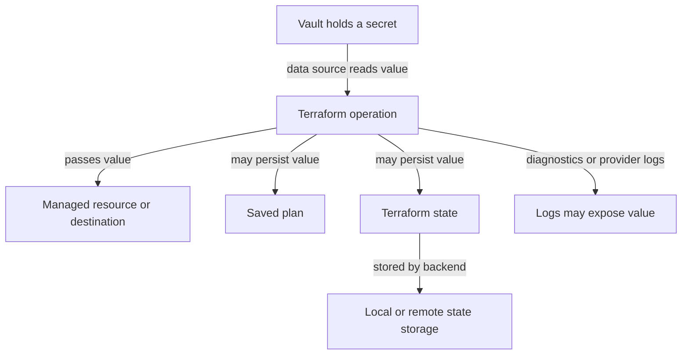
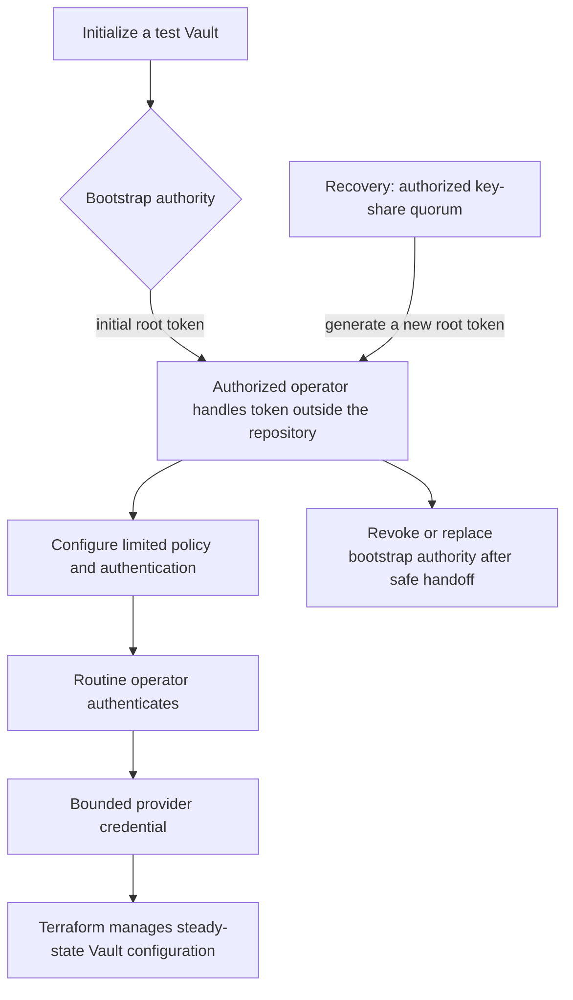

# Terraform + Vault 01 — Terraform with Vault

Prerequisites: [Terraform 03 — HCL and modules](../terraform/03-modules.md) and
[Vault 04 — PKI and transit](../vault/04-pki-transit.md).

## Why

Terraform and Vault each protect a different part of the workflow. The join
between them is where most secrets leak: a value read from Vault can move into
Terraform state, a saved plan, provider logs, or a managed resource. This
slice makes that boundary visible before you choose a safer hand-off.

Start by copying the Terraform work from
`submissions/terraform/03-modules/code/` into
`submissions/terraform-vault/01-terraform-vault/code/terraform/`. Copy the Vault work from
`submissions/vault/04-pki-transit/code/` into
`submissions/terraform-vault/01-terraform-vault/code/vault/`. Keep the two tracks in separate
paths and extend them in this new folder. Use fictitious test values. Redact
credentials, tokens, secret values, and private key material from evidence.
Follow the [Terraform evidence guidance](../../grading.md#terraform-evidence-without-duplicate-logs).

## Concepts

- Vault provider
- data source versus ephemeral resource
- write-only argument
- where secrets land
- bootstrap token
- short-lived provider credentials

### Secret to state



Marking a value sensitive hides some display output. It does not remove the
value from state or saved plans. The destination and logs may also expose it.

### First-token bootstrap



Protect initialization material and recovery shares separately. A recovery
quorum is an alternative when the initial root token is unavailable. Follow
the server's seal and recovery procedures before generating a root token.
Bootstrap access must not enter configuration, plans, or state.

## Tasks

### Warm-up for Task 01 — Trace a fictional API setting

Trace a fictional API setting through a generic IaC pipeline. Work offline.
Use labels only, not a setting value.

#### Starter

`submissions/terraform-vault/01-terraform-vault/warmup/task-01.md`

```text
Setting source and IaC read: [complete]
Flow to destination: [complete]
Durable artifacts and exposure points: [complete]
Effect and limit of sensitive marking: [complete]
```

#### Done when

- The trace names the source, read, and destination in order.
- It identifies the durable artifacts that can retain the setting.
- It explains what sensitive marking hides and why storage can still expose it.

#### Evidence to produce

- The completed trace at the Starter path, with no setting value.

### Task 01 — Make a secret land in state

Use the copied Terraform and Vault work. Read a fictitious secret from Vault
with Terraform and pass its value into a managed resource. Inspect the plan
and state to find where the value is stored.

A KV test secret and the existing S3 text object form a small hand-off to investigate.
Use only a made-up value. The object can expose its contents as well as Terraform state.

#### Constraints

- Work only in `submissions/terraform-vault/01-terraform-vault/`.
- Keep Terraform code under `code/terraform/` and Vault code under `code/vault/`.
- Start from the copied work; do not replace either track with an unrelated
  example.
- Use a Vault data source and a managed resource that accepts the value.
- Use a fictitious secret with no access to a real system.
- Keep provider credentials outside the repository.
- Redact the value in plans, state inspections, logs, evidence, and answers.

#### Done when

- The copied Terraform and Vault configurations remain usable in their
  separate paths.
- Terraform reads the test secret from Vault.
- A managed resource receives the read value.
- A plan or state inspection identifies the state path or attribute containing
  the value, with the value redacted.
- The inspection shows that marking the value sensitive does not remove it
  from state.
- Evidence contains no secret, token, or provider credential.

#### Evidence to produce

- The redacted data-source and resource configuration, plus `.terraform.lock.hcl`.
- Redacted plan output.
- A redacted state inspection naming the exposed path or attribute.
- A short note explaining where the leak occurred.

### Warm-up for Task 02 — Compare delivery channels

Compare two fictional channels offline. Channel A stores a setting in a
deployment record. Channel B passes it for one operation without storing it
in that record. Neither channel describes the graded destination.

#### Starter

`submissions/terraform-vault/01-terraform-vault/warmup/task-02.md`

```text
Channel A feature and storage boundary: [complete]
Channel B feature and storage boundary: [complete]
Checks for absence from each artifact: [complete]
Destination boundary and remaining limitation: [complete]
```

#### Done when

- The comparison identifies how each channel handles the setting and selects a channel for avoiding the deployment record.
- The checks cover both a saved operation plan and the resulting record without printing a value.
- The note identifies what the destination may retain and one limit of the selected channel.

#### Evidence to produce

- The completed comparison at the Starter path.

### Task 02 — Keep a secret out of state and saved plans

Replace the state-exposing hand-off with a supported ephemeral resource or
write-only argument. Prove what is absent from state and from a saved plan,
then record the limits of the feature you selected.

Check the pinned providers' documentation before choosing a destination.
It may differ from the S3 object in Task 01 because not every argument accepts
ephemeral values or offers a write-only alternative.

#### Constraints

- Continue from Task 01 in `submissions/terraform-vault/01-terraform-vault/`.
- Use a feature supported by the pinned Terraform and provider versions.
- The secret must still reach its intended destination during the operation.
- Do not claim that `sensitive` alone, redaction, or deleting a local file
  keeps a value out of state.
- Inspect both state and a saved plan without printing the secret value.
- Keep fictitious values and provider credentials outside the repository.

#### Done when

- The chosen ephemeral or write-only path is accepted by Terraform and the
  provider.
- The intended operation succeeds without exposing the value in state.
- A saved plan contains no copy of the value.
- The evidence identifies the state and plan checks used to prove absence.
- The evidence records at least one limitation of the chosen feature, such as
  provider support, lifecycle, or where the destination stores the value.
- Evidence contains no secret, token, or provider credential.

#### Evidence to produce

- The redacted configuration using the selected supported feature.
- A redacted destination check showing that the secret reached its intended destination.
- Redacted state and saved-plan inspections proving absence.
- A short limitation note backed by the version or provider behavior tested.

### Warm-up for Task 03 — Map configuration ownership

Draw an offline ownership map for a fictional secrets mount managed by IaC.
Keep its bootstrap authority separate from routine configuration.

#### Starter

`submissions/terraform-vault/01-terraform-vault/warmup/task-03.md`

```text
Bootstrap owner and authority boundary: [complete]
IaC owner and managed mount: [complete]
Authentication and least-privilege policy relationships: [complete]
Follow-up plan checks: [complete]
```

#### Done when

- The map distinguishes the bootstrap owner and authority from the IaC owner and managed mount.
- It connects authentication and a least-privilege policy to the mount's intended access.
- The follow-up checks identify unexpected recreation or unmanaged changes.

#### Evidence to produce

- The completed ownership map at the Starter path.

### Task 03 — Manage Vault configuration with Terraform

Use Terraform to manage one Vault policy, one authentication method, and one
secrets mount. Keep the bootstrap path separate from the provider credentials
used for normal changes.

A dedicated KV mount, an AppRole auth method, and a policy for one test path
fit the earlier Vault work. Keep these objects distinct from the existing setup
unless you explicitly bring them under Terraform ownership.

#### Constraints

- Work in the copied tracks under `submissions/terraform-vault/01-terraform-vault/`.
- Manage the policy, auth method, and mount through Terraform resources.
- Use a least-privilege fictitious policy and a test-only mount.
- Use short-lived provider credentials for routine Terraform operations.
- Do not put an initial token, role credential, secret value, or private key
  in configuration, state, saved plans, or evidence.
- Review the plan before applying changes.
- Do not hand-edit objects that Terraform manages.

#### Done when

- The plan contains the policy, auth method, and mount under Terraform
  management.
- Applying the plan creates or updates all three objects in the test Vault.
- A Vault inspection confirms each object and its intended relationship.
- A follow-up plan does not try to recreate unchanged objects.
- The provider credential used for the apply is short-lived or bounded, and
  its handling is documented without revealing it.
- Evidence contains no credential, token, or secret value.

#### Evidence to produce

- Redacted Terraform resources and provider configuration.
- Redacted proposed and follow-up plan output for the three objects.
- Redacted Vault inspections for the policy, auth method, and mount.
- A note identifying the provider credential lifetime and storage boundary.

### Warm-up for Task 04 — Outline an access handoff

The fictional Parcel Ledger inventory dashboard is not a Vault server. Its
administrator must hand onboarding access to an operations team. The dashboard
supports time-limited accounts for routine work.

Write an offline handoff runbook outline for this dashboard. Do not create or
record a credential.

#### Starter

`submissions/terraform-vault/01-terraform-vault/warmup/task-04.md`

```text
Responsibilities for sender, recipient, and routine operator: [complete]
Temporary material location and handoff boundary: [complete]
How the recipient obtains bounded routine access: [complete]
Loss or exposure response: [complete]
```

#### Done when

- The outline assigns each responsibility and describes a protected temporary location and handoff.
- It describes how the recipient obtains bounded routine access without recording a credential.
- It gives a response for both lost and exposed onboarding material.

#### Evidence to produce

- The completed runbook outline at the Starter path.

### Task 04 — Write a safe first-token bootstrap

Write a short runbook for creating and handing off the first Vault token that
can run the Terraform configuration. Distinguish that bootstrap event from
later short-lived provider credentials, and state what happens if the
bootstrap credential is lost or exposed.

#### Constraints

- Base the runbook on the test server and Terraform ownership from this slice.
- Do not include a real command output, token, key share, secret, or
  credential value.
- Identify who performs bootstrap, where material is held temporarily, how it
  reaches the operator, and when it is revoked or replaced.
- Require least privilege for routine Terraform work.
- Include a recovery or rotation path for loss and exposure.
- Keep Vault bootstrap ownership distinct from Terraform-managed steady-state
  configuration.

#### Done when

- The runbook names a safe first-token creation and handoff sequence.
- It keeps bootstrap material outside the repository and ordinary plan/state
  artifacts.
- It explains how the first token is exchanged for bounded provider
  credentials.
- It identifies the owner for bootstrap, Terraform configuration, and Vault
  runtime operations.
- It describes what to do after loss or suspected exposure.
- A reviewer can follow the runbook without seeing any secret value.

#### Evidence to produce

- The redacted bootstrap runbook.
- A responsibility table or equivalent ownership record.
- A redacted review or test record showing the sequence was checked.
- A note describing the loss and exposure response.

## Ungraded exercise — Spot the leak in state

Review this partial, fictional state excerpt. The placeholder is not a secret.

```json
{
  "resources": [
    {
      "type": "fictional_delivery",
      "instances": [
        {
          "attributes": {
            "setting": "<REDACTED-TEST-VALUE>"
          }
        }
      ]
    }
  ]
}
```

Assume the provider marks `setting` as sensitive.

### Constraints

- Work offline. Do not create or submit state or a real value.
- Treat the excerpt as illustrative, not as a complete state format.

### Done when

- The review identifies the exposed attribute and who could read it.
- It explains the limit of sensitive marking and proposes a safer handoff.

### Evidence to produce

- A value-free review in `submissions/terraform-vault/01-terraform-vault/warmup/spot-state.md`.

## Explain

Answer these questions in `submissions/terraform-vault/01-terraform-vault/answers.md`.

### Explain 1

**Situation:** A Vault policy lets only the deploy role read a database password. Terraform reads that password with a data source and marks the related output `sensitive`. The plan hides the value. Every developer can read the Terraform state bucket.

**Question:** After apply, does the Vault policy still limit who can read the password?

**A solid answer covers:**

- Where the password value lands after plan and apply.
- What the `sensitive` marking changes and what it does not change.
- Who can now read the password without asking Vault.

### Explain 2

**Situation:** You change the configuration. It now reads the password with an ephemeral resource and passes it to a write-only argument.

**Question:** What does Terraform now keep out of state and saved plans, and what risks remain?

**A solid answer covers:**

- Which Terraform artifacts no longer contain the value.
- Where the value can still appear or be stored.
- Which limits apply, such as provider support and how Terraform detects a changed value.

### Explain 3

**Situation:** Terraform manages a Vault policy. During an incident, an administrator runs `vault policy write` to grant one team extra access. Nobody changes the Terraform code.

**Question:** What happens at the next apply, and how should the team handle manual changes?

**A solid answer covers:**

- What Terraform does with the manual change.
- Who owns the policy once Terraform manages it.
- A process for emergency changes that keeps code and Vault in agreement.
