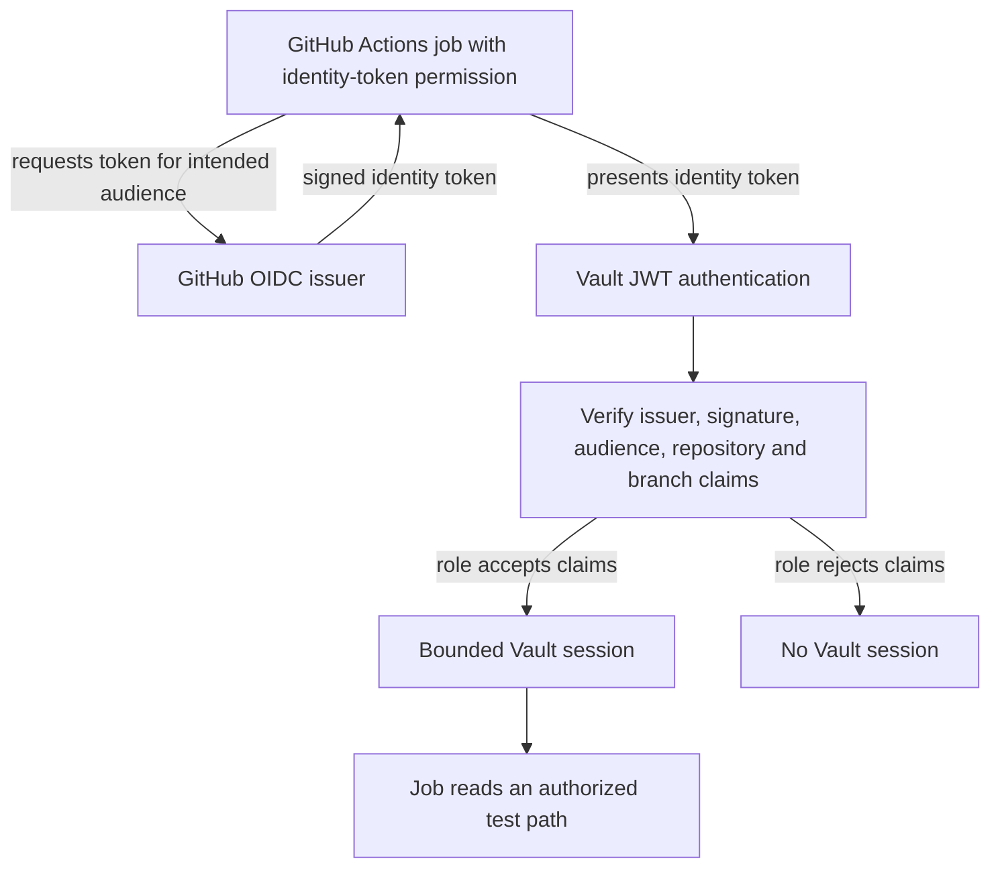
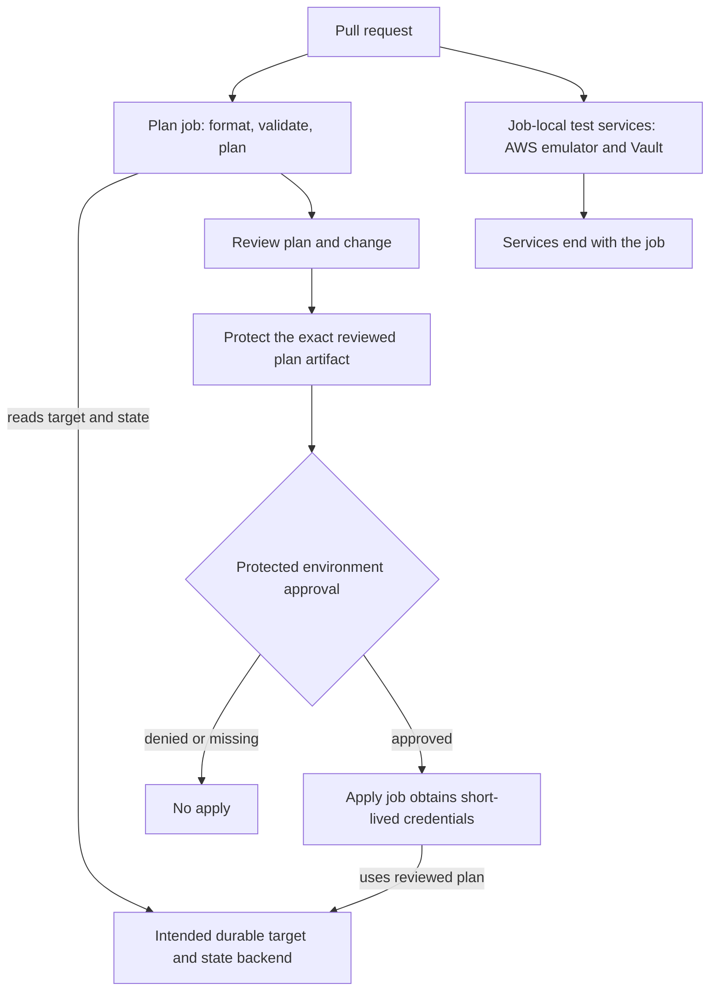

# Terraform + Vault 02 — CI/CD with no stored secrets

Prerequisite: [Terraform + Vault 01 — Terraform with Vault](01-terraform-vault.md).

## Why

Clients want Terraform changes reviewed and repeatable. They do not want
production applies to depend on one laptop, or cloud passwords copied into
repository settings and forgotten there. A safer pipeline plans changes on a
pull request, applies only after approval, and obtains short-lived access
when the job runs.

This slice uses GitHub Actions, a local AWS target, and Vault in a public training
repository. The Vault server started inside a job exists only for that job.
A real client Vault must be reachable from the runner, with network access,
trust settings, and an authentication configuration suitable for the
client's environment.

Start by copying the Terraform and Vault work from
`submissions/terraform-vault/01-terraform-vault/code/` into
`submissions/terraform-vault/02-ci/code/`. Keep the Terraform and Vault tracks in their
separate paths and extend them for CI. Use only fictitious test values.
Redact tokens, secret values, and identity-token contents from evidence.

Keep the small local AWS resource set from the copied work.
This slice adds workflow jobs, service containers, a Vault JWT role and policy,
and a protected GitHub environment. It does not need another application or cloud service.
GitHub executes workflow files from `.github/workflows/` in the public training repository.
Keep the submitted workflow source in this slice's `code/` folder too.

## Concepts

- plan on pull request
- apply behind approval
- service containers
- OIDC
- JWT auth
- bound claims
- token permissions
- pinned actions

### OIDC trust exchange



GitHub subjects vary by event, environment, and repository settings, including
immutable IDs. Inspect the relevant verified claims for the actual workflow.
Do not assume one subject format covers every run.

### Pull-request plan and approved apply



Job-local services do not persist into a later job. A client pipeline needs
reachable durable services and a protected state backend. A plan for
disposable services cannot stand in for a plan against a durable target.
Protect saved plans as sensitive artifacts. Do not expose protected
credentials to untrusted pull-request code.

## Tasks

### Warm-up for Task 01 — Classify a CI pipeline

Classify a fictional pipeline offline. A change request proposes a release
manifest. A reviewer must approve the change before publication.

#### Starter

`submissions/terraform-vault/02-ci/warmup/task-01.md`

```text
Plan job and its allowed actions: [complete]
Approval point and reviewer decision: [complete]
Apply job boundary: [complete]
Action pinning and minimum job permissions: [complete]
No-apply review check: [complete]
```

#### Done when

- The classification identifies the permitted actions in plan and apply jobs and where the reviewer intervenes.
- It specifies immutable action references and the minimum permissions for each job.
- The review check would detect an apply action in the plan job.

#### Evidence to produce

- The completed classification at the Starter path.

### Task 01 — Publish a reviewed Terraform workflow

Push the training repository to a public GitHub repository. Add a workflow
that runs Terraform format, validation, and plan for a pull request. Keep
apply out of the pull-request job and make the workflow's action versions
explicitly pinned.

#### Constraints

- Work only in `submissions/terraform-vault/02-ci/` and the public training repository.
- Start from the copied Terraform and Vault work from Terraform + Vault 01.
- Use fictitious configuration and test values only.
- Do not commit cloud passwords, Vault tokens, private keys, or identity
  tokens.
- Give the workflow only the token permissions it needs.
- Pin third-party actions to immutable references according to the policy
  agreed for the training repository.
- The pull-request job must format, validate, and plan without applying.

#### Done when

- The repository is public and the workflow file is present on the default
  branch.
- A pull request run completes Terraform format, validation, and plan.
- The pull-request job does not apply infrastructure.
- Action references are pinned and the job permissions are visible for review.
- The workflow output and repository contents contain no stored secret or
  token value.

#### Evidence to produce

- The public repository URL and workflow file path.
- Redacted pull-request run summary showing format, validation, and plan.
- The reviewed permissions and action-pinning record.
- A note showing where apply is intentionally excluded.

### Warm-up for Task 02 — Draw a disposable job network

Draw an offline job network with a fictional test database and policy
service. Both services exist only for the job.

#### Starter

`submissions/terraform-vault/02-ci/warmup/task-02.md`

```text
Job and service definitions: [complete]
Endpoints and network paths: [complete]
Readiness dependencies before the client runs: [complete]
What disappears when the job ends: [complete]
```

#### Done when

- The diagram names both services and connects the job to their test endpoints.
- It places both readiness checks before client access.
- It identifies the services and data that disappear at job completion.

#### Evidence to produce

- The completed network diagram at the Starter path.

### Task 02 — Run the local AWS target and Vault as job services

Run the local AWS emulator and Vault as service containers in the workflow.
Make the Terraform job wait for both services and use only the test
configuration needed by this slice.

#### Constraints

- Continue from Task 01 and use the copied code under `code/terraform/` and
  `code/vault/`.
- Start the local AWS target and Vault as service containers of the job, not as long-lived
  external infrastructure.
- Use health or readiness checks before Terraform accesses either service.
- Keep bootstrap setup separate from the credentials used for normal changes.
- Use fictitious values and a test-only Vault mount.
- Do not store a bootstrap token or other credential in the repository,
  workflow, or evidence.
- Record that a job-local Vault is destroyed with the job and is not a
  substitute for a client's reachable Vault.

#### Done when

- The workflow starts both service containers.
- The job proves that the local AWS target and Vault are ready before the Terraform steps.
- Terraform can reach the intended test endpoints from the job.
- A job completion leaves no expectation that the service-container Vault
  persists.
- The evidence distinguishes the ephemeral test Vault from the reachable
  Vault required in a client pipeline.

#### Evidence to produce

- Redacted service definitions and readiness output.
- Redacted Terraform endpoint configuration.
- A job summary showing both services were used.
- A short lifecycle and real-client reachability note.

### Warm-up for Task 03 — Diagram an identity exchange

Diagram an offline exchange for a fictional CI issuer and a service that
protects one test path. Do not create or record a token.

#### Starter

`submissions/terraform-vault/02-ci/warmup/task-03.md`

```text
Job identity-token permission and request: [complete]
Issuer, signature, and audience checks: [complete]
Exchange and bounded session for the test path: [complete]
Redaction and session cleanup: [complete]
```

#### Done when

- The diagram shows the job's identity-token permission and request, plus issuer, signature, and audience checks.
- It traces the exchange to a bounded session that can read only the test path without a stored service token.
- The record excludes token contents and describes redaction and session cleanup.

#### Evidence to produce

- The completed exchange diagram at the Starter path.

### Task 03 — Authenticate to Vault with GitHub OIDC

Configure the job to request a GitHub identity token, exchange it through
Vault's JWT authentication, and read a fictitious secret. Do not put a Vault
token in GitHub secrets or in the workflow file.

#### Constraints

- Continue from the job services in Task 02.
- Enable only the identity-token permission required by the job.
- Configure Vault JWT authentication for the test job.
- Use the GitHub identity token as the authentication input and read one
  fictitious secret through the resulting Vault session.
- Do not save, print, upload, or commit the identity token, Vault token, or
  secret value.
- Keep temporary test bootstrap material separate from any stored repository
  or organization secret.
- Redact token-shaped values and secret values from logs and evidence.

#### Done when

- The job requests a GitHub identity token with an explicit permission.
- Vault accepts that identity and returns a bounded session for the job.
- The job reads the expected fictitious secret without a stored Vault token.
- The resulting session is not reused as a long-lived repository credential.
- Logs and evidence prove the exchange without exposing token or secret
  contents.

#### Evidence to produce

- Redacted workflow permissions and authentication configuration.
- Redacted Vault audit or job output showing successful JWT authentication.
- A redacted secret-read result that names the path or field without its value.
- A note identifying temporary bootstrap handling and cleanup.

### Warm-up for Task 04 — Compare branch claims

Compare two fictional GitHub Actions runs triggered by push events. Both have
the verified `repository` claim `example-org/field-guide`. Their verified `ref`
claims are `refs/heads/release` and `refs/heads/draft`, respectively. The
deployment role permits branch `release` but not branch `draft`. Assume
issuer, signature, and audience checks pass. Work offline without inspecting
a token or relying on a subject format.

#### Starter

`submissions/terraform-vault/02-ci/warmup/task-04.md`

```text
Repository restriction for both runs: [complete]
Branch claim and restriction: [complete]
Release-branch result and reason: [complete]
Draft-branch result and reason: [complete]
```

#### Done when

- The comparison identifies the same permitted repository for both runs and the claim that restricts the branch.
- It explains why the release run is allowed and the draft run is rejected, assuming other trust checks pass.
- Neither result includes token contents.

#### Evidence to produce

- The completed branch comparison at the Starter path.

### Task 04 — Restrict the role to one repository and branch

Bind the Vault role to the public training repository and its intended branch.
Run the workflow from that branch, then prove that an otherwise similar
workflow from another branch is rejected.

#### Constraints

- Continue from the JWT authentication in Task 03.
- Bind the role to one repository and one branch using verified GitHub claims.
- Do not use a wildcard repository or branch to make the test pass.
- Keep the role least-privilege and bounded to the test secret and required
  authentication actions.
- Test both the allowed branch and a different branch with the same test
  setup.
- Do not expose identity tokens, Vault tokens, or secret values in evidence.

#### Done when

- The allowed repository and branch authenticate successfully.
- The role's repository and branch restrictions are visible in redacted
  configuration or inspection output.
- A different branch is rejected by Vault authentication.
- The failed run does not receive the test secret.
- Evidence identifies the claim that limits the role to the repository and
  branch without printing token contents.

#### Evidence to produce

- Redacted role and bound-claim inspection.
- Successful allowed-branch run summary.
- Redacted rejected-branch run summary and failure reason.
- A note proving the rejected run did not read the secret.

### Warm-up for Task 05 — Audit a fictional CI log

Review this fictional log excerpt offline. A job uses a reviewed plan after
approval and authenticates with a short-lived session. Each marker stands for
a value, not an actual credential or connection string. Do not add a workflow.

```text
authentication output: <TOKEN-SHAPED-REDACTED>
diagnostic output: <SETTING-REDACTED>
connection output: <CONNECTION-STRING-REDACTED>
```

#### Starter

`submissions/terraform-vault/02-ci/warmup/task-05.md`

```text
Token-shaped output risk: [complete]
Diagnostic output risk: [complete]
Connection-string output risk: [complete]
Log review checks and prevention: [complete]
Approval boundary and reviewed-plan handoff: [complete]
Credential lifetime and exposure response: [complete]
```

#### Done when

- The audit explains the risk of each of the three output types.
- The checklist covers Terraform, authentication, and debug output and names ways to prevent disclosure.
- The record locates approval before apply, protects the reviewed plan handoff, and addresses session lifetime and exposure.
- The audit contains no token, setting value, or connection string.

#### Evidence to produce

- The completed log audit at the Starter path.

### Task 05 — Gate apply and review CI log exposure

Add the apply path behind an explicit GitHub environment approval. Review the
workflow and its logs for values that could leak through command output,
Terraform diagnostics, Vault responses, or debug logging.

#### Constraints

- Continue from the pull-request plan and authentication work in the earlier
  tasks.
- Require an explicit protected-environment approval before apply.
- Apply only a reviewed plan from the intended workflow path.
- Keep token permissions minimal and do not enable broad debug logging.
- Use masking and redaction where the platform supports them, but do not
  treat masking as permission control.
- Do not put secret values, tokens, private keys, or cloud passwords in
  evidence.

#### Done when

- A pull request produces a plan without applying.
- A reviewed change reaches apply only after the configured approval.
- The apply job uses short-lived job credentials rather than a stored Vault
  token.
- A log review records what could leak in CI and confirms that test secrets
  and tokens are absent.
- The workflow's permissions, approval boundary, and failure behavior are
  documented.

#### Evidence to produce

- Redacted pull-request and approved-apply run summaries.
- Protected-environment approval record.
- Redacted log review covering Terraform, Vault, and debug output.
- A short list of values that must never be printed in CI.

## Ungraded exercise — Spot the leak in a workflow

Review this partial workflow fragment. It is not a runnable workflow and
contains no credential.

```yaml
steps:
  - name: Inspect authentication
    run: echo "${{ secrets.FICTIONAL_SERVICE_TOKEN }}"
  # Remaining steps omitted.
```

### Constraints

- Work offline. Do not add the fragment to a workflow or supply a value.
- Do not assume log masking prevents all disclosure.

### Done when

- The review identifies the risky output and where the value could appear.
- It proposes a safer diagnostic and explains why masking is not access control.

### Evidence to produce

- A value-free review in `submissions/terraform-vault/02-ci/warmup/spot-workflow.md`.

## Ungraded exercise — Spot the over-broad claim

Review this partial, fictional JWT role fragment. It is not a runnable
configuration.

```yaml
bound_claims_type: glob
bound_claims:
  repository: "*"
  ref: "refs/heads/*"
# Issuer, audience, signature validation, and other settings omitted.
```

### Constraints

- Work offline. Do not request or inspect an identity token.
- Consider the actual event and verified claims rather than assuming a subject format.

### Done when

- The review explains which repository and branch restrictions are missing.
- It names the issuer, signature, audience, repository, and branch checks needed for the intended trust boundary.
- It identifies an unauthorized run that the broad claim could admit.

### Evidence to produce

- A value-free review in `submissions/terraform-vault/02-ci/warmup/spot-claim.md`.

## Explain

Answer these questions in `submissions/terraform-vault/02-ci/answers.md`.

### Explain 1

**Situation:** Workflow A stores a Vault token that lasts one year as a repository secret. Workflow B gets a Vault token through GitHub OIDC for each run. In both workflows, a compromised third-party action copies the Vault credential it can see.

**Question:** Compare what the attacker can do in each workflow.

**A solid answer covers:**

- How long each stolen credential works.
- Which repositories, branches, or jobs can get each credential.
- What the team must clean up or rotate in each case.

### Explain 2

**Situation:** A Vault JWT role trusts GitHub's OIDC issuer and checks only the audience. You want only the `main` branch of one repository to run apply.

**Question:** Who can log in with the current role? Which claims do you bind, and why?

**A solid answer covers:**

- What the issuer and audience prove, and what they do not prove.
- The claim that limits the repository, and the claim that limits the branch.
- Why a repository limit alone is not enough for apply.

### Explain 3

**Situation:** A reviewer finds a database connection string in the log of a failed apply job. The Terraform variable that holds the password is marked `sensitive`.

**Question:** How could the value reach the log, and how should the workflow reduce that risk?

**A solid answer covers:**

- At least two ways a secret can reach a CI log or artifact despite the `sensitive` marking.
- What GitHub log masking does and does not catch.
- Workflow changes that reduce the risk.
