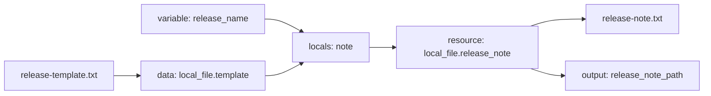

# Terraform 00 — Block types

Prerequisite: [Terraform tool installation](../../setup.md#install-the-tools).

## Why

Terraform configurations are made of blocks. Knowing what each block does helps
you read a configuration before you run it and choose the right place for each
value.

This foundations slice needs only Terraform. It does not need containers, AWS, or a
cloud account.
No cloud setup is needed.

Use the provided `submissions/terraform/00-block-types/` folder.
Its `example/` and `code/` folders keep the example and your task separate.

## Concepts

### HCL building blocks

- A **block** is a named section of configuration, such as `resource` or
  `variable`.
- A **block type** says what Terraform should do with that section.
- A **label** identifies a block instance, such as `report` in
  `resource "local_file" "report"`.
- An **argument** assigns a value inside a block, such as `content = "hello"`.

The five block types in this slice are linked to their official references:

| Block type | What it does | Why it exists | What breaks when it is missing |
|---|---|---|---|
| [`resource`](https://developer.hashicorp.com/terraform/language/block/resource) | Manages an object through its lifecycle. | It tells Terraform what to create, change, or delete. | Terraform has nothing to manage, so the intended object is not created or updated. |
| [`data`](https://developer.hashicorp.com/terraform/language/block/data) | Reads an object that already exists outside this configuration. | It lets the configuration use existing information without managing that object's lifecycle. | Terraform cannot obtain that external value, or you have to hard-code a value that can go stale. |
| [`variable`](https://developer.hashicorp.com/terraform/language/block/variable) | Accepts a value from the person or system calling the configuration. | It keeps environment- or caller-specific input out of the configuration. | Callers cannot provide the input cleanly; you must edit the configuration or hard-code it. |
| [`locals`](https://developer.hashicorp.com/terraform/language/block/locals) | Gives a name to a value derived inside the configuration. | It keeps repeated expressions consistent and readable. | The configuration repeats expressions, making changes easier to miss or apply inconsistently. |
| [`output`](https://developer.hashicorp.com/terraform/language/block/output) | Publishes a value after Terraform evaluates the configuration. | It gives people, parent modules, and automation a supported result to consume. | The value may exist in state but is not presented as a useful result to the caller. |

An output's `value` is an expression. It can produce a string, number, boolean,
or collection. The expression can be a literal or a reference to another value.

Use these rules when two choices look similar:

- Choose **`resource`** when Terraform should create, update, or delete the
  object. Choose **`data`** when the object already exists and Terraform only
  needs to read it.
- Choose **`variable`** when a caller supplies the value. Choose **`locals`**
  when the configuration derives the value from its own inputs and resources.

### Run an annotated example

This example creates a release note from an existing template. Run it in
`submissions/terraform/00-block-types/example/`, not in the task's `code/` folder.

The folder contains `release-template.txt`:

```text
Release RELEASE_NAME is ready for review.
```

The included `versions.tf` selects the local provider in a
[`terraform` block](https://developer.hashicorp.com/terraform/language/block/terraform):

```hcl
terraform {
  required_providers {
    local = {
      source  = "hashicorp/local"
      version = "2.5.3"
    }
  }
}
```

The included `main.tf` contains the five block types:

```hcl
variable "release_name" {
  type        = string
  description = "Name supplied by the release job."
}

data "local_file" "template" {
  # The template already exists; Terraform only reads it.
  filename = "${path.module}/release-template.txt"
}

locals {
  # This value is derived from the caller's name and the existing template.
  note = replace(data.local_file.template.content, "RELEASE_NAME", var.release_name)
}

resource "local_file" "release_note" {
  # Terraform manages this generated file.
  filename = "${path.module}/release-note.txt"
  content  = local.note
}

output "release_note_path" {
  # The release job can consume this result.
  value = local_file.release_note.filename
}
```

The values flow through the blocks like this:



The resource writes the file. The output exposes its path, not its contents.

Run these commands from the repository root. Initialization downloads the local
provider. Review the proposed file creation, then enter `yes` at the apply prompt.

```bash
terraform -chdir=submissions/terraform/00-block-types/example init
terraform -chdir=submissions/terraform/00-block-types/example apply -var='release_name=training-01'
cat submissions/terraform/00-block-types/example/release-note.txt
```

Terraform prints the generated file's path. The file contains:

```text
Release training-01 is ready for review.
```

### Files Terraform creates

Terraform needs more than configuration files to manage resources. `init` prepares
the working folder. `apply` records what Terraform manages and creates the
resources described by your configuration.

For this example, the files have different purposes:

| File or folder | When it appears | Purpose | Commit to Git? |
|---|---|---|---|
| `.terraform/` | `terraform init` | Stores downloaded providers and modules, plus working metadata such as backend settings. | No. Run `terraform init` to recreate it. |
| `.terraform.lock.hcl` | `terraform init` selects providers | Records the selected provider versions and package checksums for repeatable installation. | Yes. Review and commit intended changes. |
| `terraform.tfstate` | `terraform apply` saves local state | Maps resource addresses to managed objects and records their attributes and outputs. | No. Keep it locally while you manage these resources. |
| `terraform.tfstate.backup` | A later operation replaces existing local state | Holds the previous state snapshot for recovery. | No. Protect it like the current state. |
| `.terraform.tfstate.lock.info` | A local operation holds a state lock | Identifies the operation that holds the lock. Terraform normally removes it afterward. | No. Do not remove it while an operation runs. |
| `release-note.txt` | This example's `terraform apply` | Is the file created by the `local_file` resource, not a Terraform internal file. | No for this example. Other generated files depend on the configuration. |

With `-chdir`, these files appear in the selected folder, not the repository root.
Hidden files start with a dot. Enable hidden-file display in your file browser
to see `.terraform/` and `.terraform.lock.hcl`.

The dependency lock file and the state lock serve different purposes.
`.terraform.lock.hcl` records provider choices. The temporary state lock prevents
conflicting operations against the same state.

#### Keep state, not just configuration

State is Terraform's record of which objects it manages. It is not a disposable
cache. Deleting state does not delete the resources.
Without that record, a later apply can propose duplicate resources or fail
because objects already exist.

Keep local state and its backups until the resources are destroyed or the state
is safely migrated. Do not edit state by hand.
The [state and drift slice](02-state.md) covers remote state and locking in
more detail.

!!! warning "State and plans can contain secrets"
    Local state, backups, and saved plans can contain passwords, tokens, and resource data.
    Marking a value `sensitive` hides normal output, but does not remove it from state.
    Do not commit these files or paste their raw contents into evidence.
    `.gitignore` does not encrypt files or stop Git from tracking files already committed.

#### What belongs in Git

Commit your `.tf` files, `.terraform.lock.hcl`, and non-secret source files such as
`release-template.txt`. Keep the dependency lock file even when you pin a provider
version in `versions.tf`. Its checksums also verify downloaded provider packages.

The repository ignores `.terraform/`, local state, common saved-plan names, local
`.tfvars` files, and `.env` files across all slices. A saved plan can have any name.
Use a `.tfplan` extension so the ignore rule catches it.
Use example variable files such as `training.tfvars.example` for fictional values
that belong in Git. The supplied Mossvale customer fixture is an explicit exception.

From the repository root, inspect what Git sees:

```bash
git status --short --untracked-files=all
git status --short --ignored submissions/terraform/00-block-types/example/
git check-ignore -v submissions/terraform/00-block-types/example/terraform.tfstate
```

In short status output, `??` means untracked and `!!` means ignored.
The dependency lock file should remain visible to Git.
Ignoring a file keeps it out of ordinary Git additions, not out of your working folder.

#### Clean up the example safely

Deleting `.terraform/` removes downloaded dependencies and working metadata, not
the managed resources. Reinitialize afterward. Do not delete it during an operation.
For remote backends, keep the backend settings available before reinitializing.

To remove the generated release note, let Terraform destroy this example's resource.
Run this command from the repository root:

```bash
terraform -chdir=submissions/terraform/00-block-types/example destroy -var='release_name=training-01'
```

Review the proposed deletion before entering `yes`.
Terraform removes `release-note.txt` and updates state. State files can remain
after destroy, but the state no longer tracks that resource.
The template, configuration, and dependency lock file remain.
Run the earlier apply command again to recreate the example.

For reference, see HashiCorp's [working directory guide](https://developer.hashicorp.com/terraform/cli/init)
and [dependency lock file guide](https://developer.hashicorp.com/terraform/language/files/dependency-lock).

## Tasks

### Task 01 — Build a five-block local report

Create a small Terraform configuration in
`submissions/terraform/00-block-types/code/`. Use the `local` provider only.
Create `source.txt` in the same folder with a short sentence about a fictional
project. Terraform will read that existing file and write a separate report
file.

Use this scaffold as the starting structure. Replace every `???` with your own
choice before running Terraform. The scaffold is intentionally incomplete; it
is not a finished answer. The unquoted `???` in the output is a placeholder for
an expression, not valid Terraform syntax.

```hcl
# versions.tf — this installation metadata is provided for the local provider.
terraform {
  required_providers {
    local = {
      source  = "hashicorp/local"
      version = "2.5.3"
    }
  }
}
```

```hcl
# main.tf — complete the blanks.
variable "project_name" {
  type        = string
  description = "???"
}

data "local_file" "source" {
  filename = "???"
}

locals {
  report_filename = "???"
  report_content  = "Project: ${var.project_name}\n\n${data.local_file.source.content}"
}

resource "local_file" "report" {
  filename = local.report_filename
  content  = local.report_content
}

output "report_path" {
  value = ???
}
```

Run Terraform from the `code/` folder. Pass a project name when you apply.
Keep the generated report separate from `source.txt`.

#### Constraints

- Use all five block types exactly as intended: `resource`, `data`, `variable`,
  `locals`, and `output`.
- Use only the `local` provider. Do not add a cloud provider or provider
  configuration block.
- Keep the configuration and `source.txt` in
  `submissions/terraform/00-block-types/code/`.
- Do not copy the annotated release-note example into the task.
- Do not put secrets or real credentials in the files.

#### Done when

- Every scaffold blank is replaced and the configuration passes
  `terraform fmt` and `terraform validate`.
- `terraform init` installs only the pinned local provider.
- A plan shows one managed report file to create and no cloud resources.
- An apply creates the report with the supplied project name and the contents
  read from `source.txt`.
- The output prints the path of the generated report, and the report remains
  separate from `source.txt`.

#### Evidence to produce

- The completed `.tf` files and `source.txt`.
- `terraform fmt` and `terraform validate` output.
- Initialization and plan output showing the local provider and one report.
- Apply output, the printed report path, and the report contents.

## Explain

Answer these questions in `submissions/terraform/00-block-types/answers.md`.

### Explain 1

**Situation:** Your configuration reads `source.txt` with a `data "local_file"` block. A teammate changes it to a `resource "local_file"` block with the same filename. Later, someone runs `terraform destroy`.

**Question:** What happens to `source.txt` in each version of the configuration?

**A solid answer covers:**

- What Terraform does with an object it reads.
- What Terraform does with an object it manages, at apply and at destroy.
- Why this difference matters for files or resources that other people own.

### Explain 2

**Situation:** A release job runs your configuration once for each project and passes in the project name. A teammate suggests that the job should also pass in the report filename, "for flexibility".

**Question:** Should the report filename be a `variable`, or should it stay in `locals`? Explain your choice.

**A solid answer covers:**

- Who supplies each value, and who should decide it.
- One problem that can happen if the caller controls the filename.
- A situation where a separate filename variable would be the better choice.

### Explain 3

**Situation:** After apply, a later step in the release job must upload the generated report. A teammate wants that step to read the report path from `terraform.tfstate` with a script.

**Question:** Why is an `output` block a better way to give the job that path?

**A solid answer covers:**

- What an `output` gives the caller.
- Why reading the state file directly is fragile or unsafe.
- What the job would have to do if no output exists.
