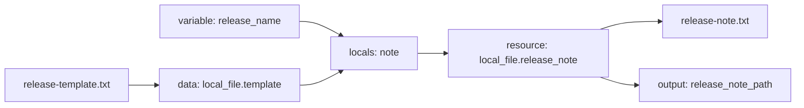

# Terraform 00 — Block types

Prerequisite: [Terraform tool installation](../../setup.md#install-the-tools).

## Why

Terraform configurations are made of blocks. Knowing what each block does helps
you read a configuration before you run it and choose the right place for each
value.

This foundations slice needs only Terraform. It does not need containers, AWS, or a
cloud account.
No cloud setup is needed.

Use the provided `submissions/terraform/00-block-types/` folder.
Its `example/` and `code/` folders keep the example and your task separate.

## Concepts

### HCL building blocks

- A **block** is a named section of configuration, such as `resource` or
  `variable`.
- A **block type** says what Terraform should do with that section.
- A **label** identifies a block instance, such as `report` in
  `resource "local_file" "report"`.
- An **argument** assigns a value inside a block, such as `content = "hello"`.

The five block types in this slice are:

| Block type | What it does | Why it exists | What breaks when it is missing |
|---|---|---|---|
| `resource` | Manages an object through its lifecycle. | It tells Terraform what to create, change, or delete. | Terraform has nothing to manage, so the intended object is not created or updated. |
| `data` | Reads an object that already exists outside this configuration. | It lets the configuration use existing information without managing that object's lifecycle. | Terraform cannot obtain that external value, or you have to hard-code a value that can go stale. |
| `variable` | Accepts a value from the person or system calling the configuration. | It keeps environment- or caller-specific input out of the configuration. | Callers cannot provide the input cleanly; you must edit the configuration or hard-code it. |
| `locals` | Gives a name to a value derived inside the configuration. | It keeps repeated expressions consistent and readable. | The configuration repeats expressions, making changes easier to miss or apply inconsistently. |
| `output` | Publishes a value after Terraform evaluates the configuration. | It gives people, parent modules, and automation a supported result to consume. | The value may exist in state but is not presented as a useful result to the caller. |

Use these rules when two choices look similar:

- Choose **`resource`** when Terraform should create, update, or delete the
  object. Choose **`data`** when the object already exists and Terraform only
  needs to read it.
- Choose **`variable`** when a caller supplies the value. Choose **`locals`**
  when the configuration derives the value from its own inputs and resources.

### Run an annotated example

This example creates a release note from an existing template. Run it in
`submissions/terraform/00-block-types/example/`, not in the task's `code/` folder.

The folder contains `release-template.txt`:

```text
Release RELEASE_NAME is ready for review.
```

The included `versions.tf` selects the local provider:

```hcl
terraform {
  required_providers {
    local = {
      source  = "hashicorp/local"
      version = "2.5.3"
    }
  }
}
```

The included `main.tf` contains the five block types:

```hcl
variable "release_name" {
  type        = string
  description = "Name supplied by the release job."
}

data "local_file" "template" {
  # The template already exists; Terraform only reads it.
  filename = "${path.module}/release-template.txt"
}

locals {
  # This value is derived from the caller's name and the existing template.
  note = replace(data.local_file.template.content, "RELEASE_NAME", var.release_name)
}

resource "local_file" "release_note" {
  # Terraform manages this generated file.
  filename = "${path.module}/release-note.txt"
  content  = local.note
}

output "release_note_path" {
  # The release job can consume this result.
  value = local_file.release_note.filename
}
```

The values flow through the blocks like this:



The resource writes the file. The output exposes its path, not its contents.

Run these commands from the repository root. Initialization downloads the local
provider. Review the proposed file creation, then enter `yes` at the apply prompt.

```bash
terraform -chdir=submissions/terraform/00-block-types/example init
terraform -chdir=submissions/terraform/00-block-types/example apply -var='release_name=training-01'
cat submissions/terraform/00-block-types/example/release-note.txt
```

Terraform prints the generated file's path. The file contains:

```text
Release training-01 is ready for review.
```

## Tasks

### Task 01 — Build a five-block local report

Create a small Terraform configuration in
`submissions/terraform/00-block-types/code/`. Use the `local` provider only.
Create `source.txt` in the same folder with a short sentence about a fictional
project. Terraform will read that existing file and write a separate report
file.

Use this scaffold as the starting structure. Replace every `???` with your own
choice before running Terraform. The scaffold is intentionally incomplete; it
is not a finished answer.

```hcl
# versions.tf — this installation metadata is provided for the local provider.
terraform {
  required_providers {
    local = {
      source  = "hashicorp/local"
      version = "2.5.3"
    }
  }
}
```

```hcl
# main.tf — complete the blanks.
variable "project_name" {
  type        = string
  description = "???"
}

data "local_file" "source" {
  filename = "???"
}

locals {
  report_filename = "???"
  report_content  = "Project: ${var.project_name}\n\n${data.local_file.source.content}"
}

resource "local_file" "report" {
  filename = local.report_filename
  content  = local.report_content
}

output "report_path" {
  value = "???"
}
```

Run Terraform from the `code/` folder. Pass a project name when you apply.
Keep the generated report separate from `source.txt`.

#### Constraints

- Use all five block types exactly as intended: `resource`, `data`, `variable`,
  `locals`, and `output`.
- Use only the `local` provider. Do not add a cloud provider or provider
  configuration block.
- Keep the configuration and `source.txt` in
  `submissions/terraform/00-block-types/code/`.
- Do not copy the annotated release-note example into the task.
- Do not put secrets or real credentials in the files.

#### Done when

- Every scaffold blank is replaced and the configuration passes
  `terraform fmt` and `terraform validate`.
- `terraform init` installs only the pinned local provider.
- A plan shows one managed report file to create and no cloud resources.
- An apply creates the report with the supplied project name and the contents
  read from `source.txt`.
- The output prints the path of the generated report, and the report remains
  separate from `source.txt`.

#### Evidence to produce

- The completed `.tf` files and `source.txt`.
- `terraform fmt` and `terraform validate` output.
- Initialization and plan output showing the local provider and one report.
- Apply output, the printed report path, and the report contents.

## Explain

Answer these questions in
`submissions/terraform/00-block-types/answers.md`.

### Explain 1

An object already exists in the working folder, and Terraform should include
its contents in a generated file but must not manage the existing object's
lifecycle. Should the configuration use `data` or `resource`? Why?

### Explain 2

A release job must provide a project name, while the report filename is
derived from that name inside the configuration. Which value belongs in a
`variable`, and which belongs in `locals`? Why?

### Explain 3

The generated report exists after apply, but another automation step needs its
path. Which block publishes that path, and what is missing if the block is
omitted?
