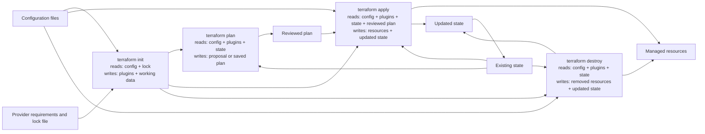

# Terraform 01 — Terraform workflow

Prerequisites: [Terraform 00 — Block types](00-block-types.md) and [local setup](../../setup.md).

## Why

Clients need infrastructure changes that they can review before they make them.
The Terraform workflow shows the proposed change, applies only the intended change, and leaves a record of what exists.
You will use a configured local AWS target so that you can repeat the workflow
without creating cloud resources.

Start this slice in a new folder: `submissions/terraform/01-workflow/`.

Use the local AWS target at `localhost:4566`. Set the shell variables in
[Local setup](../../setup.md) first.
Write all Terraform configuration yourself.
Follow the [Terraform evidence guidance](../../grading.md#terraform-evidence-without-duplicate-logs).
You do not need separate initialization or apply logs.

## Concepts

- providers
- resource references and dependency ordering
- plan
- apply
- destroy
- saved plans
- version pinning

The workflow reads and writes different things at each stage:



`init` reads provider requirements and lock information and prepares provider
plugins; it does not create managed resources. `plan` reads configuration,
providers, and state and produces a proposal; it does not write managed
resources. `apply` reads the reviewed proposal and state, then writes managed
resources and updated state. `destroy` reads configuration and state, removes
the managed resources, and records the resulting state.

## Where to find resource information

The [Terraform Registry](https://registry.terraform.io) documents every
provider and every resource type that the provider offers. Use it as your first
reference when you write configuration.

1. Open the [AWS provider page](https://registry.terraform.io/providers/hashicorp/aws/latest).
2. Select **Documentation**. Use the version selector to match the provider
   version that you pin.
3. Use the filter on the left to find a resource type, for example `s3_bucket`.
4. On the resource page, read **Argument Reference** to see which arguments
   you can set and which are required. Read **Attribute Reference** to see
   the values that Terraform knows after it creates the resource.

The resource pages describe real AWS. The local AWS target supports a subset of
services. The [local setup](../../setup.md) page links to the Floci documentation.

## Tasks

### Exercise — Predict the plan for a release change

A team has already applied a configuration with two `terraform_data` resources.
State records these values:

- `terraform_data.revision` has `input` set to `ready`.
- `terraform_data.release` has `triggers_replace` set to `v1`.

The proposed configuration changes `input` to `approved` and
`triggers_replace` to `v2`. The resource addresses do not change.
For `terraform_data`, changing `input` updates the resource. Changing
`triggers_replace` requires replacement.

Predict the plan before anyone runs it. Record the expected action for each
resource. Identify an unrelated action that a reviewer should investigate.

#### Constraints

- Work from the scenario only; do not run Terraform or contact a cloud account.
- Record one expected action for each `terraform_data` resource.
- Explain how the existing state helps Terraform distinguish an update from a new resource.
- Keep the artifact about the fictional release; do not copy the graded configuration.

#### Done when

- The artifact records a predicted action for both existing resources.
- The reasoning connects each changed attribute to the expected action.
- The review check identifies an unexpected action that would need investigation.

#### Evidence to produce

Save the prediction and review note as
`submissions/terraform/01-workflow/code/predict-the-plan.md`.

### Warm-up — Trace a dependency graph

Before Task 01, practice tracing references and dependency ordering without
deploying anything. Work in
`submissions/terraform/01-workflow/warmup/task-01-dependency-graph.md`.

#### Starter

Northstar uses three `terraform_data` resources. `source` contains the string
`inventory`, `label` derives its input from `source`, and `release` derives its
input from `label`. Copy this incomplete review and replace every `???`:

```markdown
# Northstar dependency review

This is a fictional graph review. It does not create resources.

| Resource | Input expression | Depends directly on |
|---|---|---|
| `terraform_data.source` | `"inventory"` | ??? |
| `terraform_data.label` | ??? | ??? |
| `terraform_data.release` | `"release-${terraform_data.label.output}"` | ??? |

## Ordering

1. First resource to create: ???
2. Second resource to create: ???
3. Last resource to create: ???
4. Why Terraform can infer this order: ???

## Diagram

`source` → ??? → ???
```

#### Done when

- Every resource row records its input expression and direct dependency
  accurately.
- The ordering respects the dependencies in the resource rows.
- The explanation identifies how Terraform infers dependencies from
  references.
- The diagram includes all three resources and accurately represents their
  dependencies.
- The completed artifact is saved as `warmup/task-01-dependency-graph.md`.

#### Evidence to produce

Submit the completed Markdown artifact in
`submissions/terraform/01-workflow/warmup/task-01-dependency-graph.md`.

### Task 01 — Reference resources in dependency order

Create a Terraform configuration in `submissions/terraform/01-workflow/code/`.
Use the configured local AWS target and manage these two resources together:

- An S3 bucket. S3 is the AWS object storage service. A bucket is a named
  container for files, which AWS calls objects. See
  [`aws_s3_bucket`](https://registry.terraform.io/providers/hashicorp/aws/latest/docs/resources/s3_bucket).
- A small text object inside that bucket. See
  [`aws_s3_object`](https://registry.terraform.io/providers/hashicorp/aws/latest/docs/resources/s3_object).

Set the object's `bucket` argument by referencing the bucket resource, not by
repeating its name. Terraform must infer that it creates the bucket before the
object. Use a short, fictional object body.

Terraform 02 copies this configuration, so later slices continue from this bucket.

#### Constraints

- Keep Terraform configuration in `submissions/terraform/01-workflow/code/`.
- Use the local AWS endpoint. Do not use a real AWS account.
- Do not add real cloud credentials or copy a finished configuration.
- Pin the AWS provider to a chosen version.
- Use one `aws_s3_bucket` and one `aws_s3_object`.
- Reference the bucket resource from the object so the dependency is implicit.
- Do not add extra resources or make endpoint configuration a separate task.

#### Done when

- Terraform initializes with the chosen provider version.
- A plan shows the bucket and the object for creation.
- An apply creates the bucket and the object in the local AWS target.
- The Terraform state and a local AWS check agree about the resources that exist.

#### Evidence to produce

- The configuration files, provider version constraint, and `.terraform.lock.hcl`.
- The plan output before creation.
- A safe state inspection and a local AWS check showing the bucket and object.

### Task 02 — Change one resource through the workflow

Change one meaningful attribute of a managed resource.
Use the plan to inspect the proposed change before you apply it.
Bucket tags or the text object's contents are small changes to explore.
Choose the value and work out the expected action yourself.

#### Constraints

- Start with the applied configuration from Task 01.
- Keep the change local and reversible.
- Do not replace the change with an unrelated refactor.
- Record the planned action before applying it.

#### Done when

- The plan shows the intended change and no unexpected resource changes.
- The apply completes against the local AWS target.
- A check of Terraform state or the local AWS target shows the new value.
- You can explain why the plan showed that action.

#### Evidence to produce

- The changed configuration.
- The plan output before the apply.
- A safe state inspection or a local AWS check showing the changed value.

### Task 03 — Remove the local resources

Destroy the resources from the same working folder and state used in the earlier tasks.

#### Constraints

- Destroy only the resources created for this slice.
- Keep the state until Terraform completes the destroy operation.
- Do not use a real AWS account.

#### Done when

- Terraform reports that the managed resources were destroyed.
- The state no longer tracks those resources.
- A local AWS check shows that the resources no longer exist.
- Your evidence identifies the working folder and state used.

#### Evidence to produce

- Destroy output.
- The resulting state inspection.
- A local AWS check that shows the resources are absent.

### Warm-up — Review a saved plan

Before Task 04, practice separating a local plan review from an apply decision.
Work in
`submissions/terraform/01-workflow/warmup/task-04-saved-plan-review.md`.

#### Starter

In a fictional review, Terraform created a saved plan for a local-file release
note. The plan proposes creating `local_file.release_note` with filename
`release-note.txt` and content `Release 7 is ready.` It also proposes no other
resource changes. The reviewer must inspect the plan before applying it.

Copy this incomplete evidence table and replace every `???`:

```markdown
# Northstar saved-plan review

| Review item | Entry |
|---|---|
| Planned resource action | ??? |
| Planned filename | ??? |
| Planned content | ??? |
| Unexpected action that would stop review | ??? |
| Evidence to record after apply | ??? |

## Decision

Apply the exact saved plan? ???
```

#### Done when

- The review entries match the supplied plan and scenario.
- The stop condition identifies a plan difference that requires further
  review.
- The evidence entry connects the reviewed plan to a post-apply check.
- The decision follows from the plan review.
- The completed artifact is saved as `warmup/task-04-saved-plan-review.md`.

#### Evidence to produce

Submit the completed Markdown artifact in
`submissions/terraform/01-workflow/warmup/task-04-saved-plan-review.md`.

### Task 04 — Apply an inspected saved plan

After Task 03 destroys the resources, recreate the same bucket and object from
the current configuration. Save the plan to a local ignored `.tfplan` file,
inspect the human-readable plan, and apply that exact saved plan.

#### Constraints

- Use the same working folder and configured local AWS target as the earlier
  tasks. Do not use a real AWS account or real credentials.
- Create the saved plan with `terraform plan -out=<local .tfplan file>`.
- Inspect the saved plan with `terraform show` before applying it.
- Apply the exact saved plan file, not a fresh plan and not `-auto-approve`
  against configuration.
- Keep the binary plan local and ignored. Do not submit it.
- Redact any sensitive values from the reviewed text evidence.

#### Done when

- The saved plan proposes recreating the bucket and object from the empty
  post-destroy state.
- The human-readable saved plan was inspected and contains no unexpected
  actions or sensitive values in submitted evidence.
- The exact saved plan is applied successfully.
- A later plan reports no changes.
- The binary saved plan remains local and is not submitted.

#### Evidence to produce

- The reviewed, redacted `terraform show` text for the saved plan.
- A record of the apply command naming the saved plan file and its output.
- A later no-change plan.
- A short note identifying the working folder and confirming that the binary
  plan was kept local and ignored.

## Explain

Answer these questions in `submissions/terraform/01-workflow/answers.md`.

### Explain 1

**Situation:** A teammate changes one attribute in the configuration and wants to run `terraform apply -auto-approve`. They say the Git diff already shows what will change.

**Question:** What can the plan show that the Git diff cannot?

**A solid answer covers:**

- The difference between a change to configuration and a change to real resources.
- At least one example where a small code change causes a larger real change.
- What the reviewer should look for in the plan before approving it.

### Explain 2

**Situation:** Your configuration has no version constraint for the AWS provider, and the dependency lock file is not committed. It works on your machine today. Six months later, a new teammate clones the repository and runs `terraform init`.

**Question:** What can be different on the new teammate's machine, and how can it change the plan?

**A solid answer covers:**

- Which provider version the teammate gets, and why.
- How a different provider version can change plan or apply results.
- What the version constraint and the lock file each control.

### Explain 3

**Situation:** Your configuration contains an `aws_s3_object` whose `bucket`
argument references `aws_s3_bucket.reports.id`. Terraform must create the bucket
before it can create the object.

**Question:** How does the resource reference create an implicit dependency, and
why does Terraform need that dependency graph to order operations?

**A solid answer covers:**

- How the object expression references an attribute of the bucket resource.
- Why Terraform can infer an edge without a separate `depends_on`.
- Why the graph prevents Terraform from trying to use the bucket before it
  exists and also guides destroy ordering.
