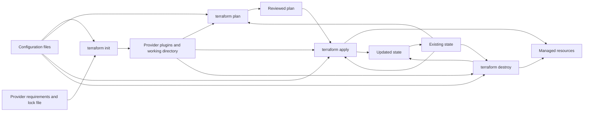

# Terraform 01 — Terraform workflow

Prerequisites: [Terraform 00 — Block types](00-block-types.md) and [local setup](../../setup.md).

## Why

Clients need infrastructure changes that they can review before they make them.
The Terraform workflow shows the proposed change, applies only the intended change, and leaves a record of what exists.
You will use a local AWS target so that you can repeat the workflow without creating cloud resources.

Start this slice in a new folder: `submissions/terraform/01-workflow/`.

Use the local AWS target at `localhost:4566`. Set the shell variables in
[Local setup](../../setup.md) first.
Write all Terraform configuration yourself.
Follow the [Terraform evidence guidance](../../grading.md#terraform-evidence-without-duplicate-logs).
You do not need separate initialization or apply logs.

## Concepts

- providers
- plan
- apply
- destroy
- version pinning
- emulator limits

The workflow reads and writes different things at each stage:



`init` reads provider requirements and lock information and prepares provider
plugins; it does not create managed resources. `plan` reads configuration,
providers, and state and produces a proposal; it does not write managed
resources. `apply` reads the reviewed proposal and state, then writes managed
resources and updated state. `destroy` reads configuration and state, removes
the managed resources, and records the resulting state.

## Where to find resource information

The [Terraform Registry](https://registry.terraform.io) documents every
provider and every resource type that the provider offers. Use it as your first
reference when you write configuration.

1. Open the [AWS provider page](https://registry.terraform.io/providers/hashicorp/aws/latest).
2. Select **Documentation**. Use the version selector to match the provider
   version that you pin.
3. Use the filter on the left to find a resource type, for example `s3_bucket`.
4. On the resource page, read **Argument Reference** to see which arguments
   you can set and which are required. Read **Attribute Reference** to see
   the values that Terraform knows after it creates the resource.

The resource pages describe real AWS. The local AWS target supports a subset of
services. The [local setup](../../setup.md) page links to the Floci documentation.

## Tasks

### Exercise — Predict the plan for a queue change

A team has already applied a local-target configuration. Its state contains
one queue and one text object in that queue. The configuration change does
three things:

- changes the text object's contents from `ready` to `approved`;
- adds a description to the queue;
- leaves the provider version and resource names unchanged.

Predict the plan before anyone runs it. Record the expected action for each
item and one reason a reviewer should reject a plan that proposes an unrelated
replacement or a resource outside this configuration.

#### Constraints

- Work from the scenario only; do not run Terraform or contact a cloud account.
- Record one expected action for the queue and one for the text object.
- Explain how the existing state helps Terraform distinguish an update from a new resource.
- Keep the artifact about the fictional queue; do not copy the graded configuration.

#### Done when

- The artifact records a predicted action for both existing resources.
- The reasoning explains why the provider version and resource names do not imply replacement.
- The review check identifies an unexpected action that would need investigation.

#### Evidence to produce

Save the prediction and review note as
`submissions/terraform/01-workflow/code/predict-the-plan.md`.

### Warm-up — Annotate a local-target manifest

Before Task 01, practice provider endpoint and plan review decisions without
deploying anything. Work in
`submissions/terraform/01-workflow/warmup/task-01-queue-manifest.md`.

#### Starter

Copy this incomplete manifest and replace every `???`:

```markdown
# Northstar queue deployment review

This is a fictional deployment proposal. It must stay on the local target.

| Review item | Your entry |
|---|---|
| Provider endpoint | ??? |
| Provider version constraint | ??? |
| Resource expected to be created | ??? |
| Resource expected to be updated | ??? |
| Resource expected to be unchanged | ??? |

## Plan-review questions

1. What evidence would show that the plan uses the local target rather than a real cloud account?
   Answer: ???
2. Which plan action would make you stop before apply, and why?
   Answer: ???
```

#### Done when

- Every blank specifies a safe local endpoint, a pinned version, or a justified review entry.
- The completed answers distinguish create, update, and no-op actions.
- The completed artifact is saved as `warmup/task-01-queue-manifest.md`.

#### Evidence to produce

Submit the completed Markdown artifact in
`submissions/terraform/01-workflow/warmup/task-01-queue-manifest.md`.

### Task 01 — Configure a local target

Create a Terraform configuration in `submissions/terraform/01-workflow/code/`.
Point its AWS provider at the local AWS target.
Manage these two resources together:

- An S3 bucket. S3 is the AWS object storage service. A bucket is a named
  container for files, which AWS calls objects. See
  [`aws_s3_bucket`](https://registry.terraform.io/providers/hashicorp/aws/latest/docs/resources/s3_bucket).
- A small text object inside that bucket. See
  [`aws_s3_object`](https://registry.terraform.io/providers/hashicorp/aws/latest/docs/resources/s3_object).

Terraform 02 copies this configuration, so later slices continue from this bucket.

**Optional:** For brownie points, choose and manage extra AWS resources that
the local target supports. These are not required to pass the slice.

#### Constraints

- Keep Terraform configuration in `submissions/terraform/01-workflow/code/`.
- Use the local AWS endpoint. Do not use a real AWS account.
- Do not add real cloud credentials or copy a finished configuration.
- Pin the AWS provider to a chosen version.

#### Done when

- Terraform initializes with the chosen provider version.
- A plan shows the bucket and the object for creation.
- An apply creates the bucket and the object in the local AWS target.
- The Terraform state and a local AWS check agree about the resources that exist.

#### Evidence to produce

- The configuration files, provider version constraint, and `.terraform.lock.hcl`.
- The plan output before creation.
- A safe state inspection and a local AWS check showing the bucket and object.

### Task 02 — Change one resource through the workflow

Change one meaningful attribute of a managed resource.
Use the plan to inspect the proposed change before you apply it.
Bucket tags or the text object's contents are small changes to explore.
Choose the value and work out the expected action yourself.

#### Constraints

- Start with the applied configuration from Task 01.
- Keep the change local and reversible.
- Do not replace the change with an unrelated refactor.
- Record the planned action before applying it.

#### Done when

- The plan shows the intended change and no unexpected resource changes.
- The apply completes against the local AWS target.
- A check of Terraform state or the local AWS target shows the new value.
- You can explain why the plan showed that action.

#### Evidence to produce

- The changed configuration.
- The plan output before the apply.
- A safe state inspection or a local AWS check showing the changed value.

### Task 03 — Remove the local resources

Destroy the resources from the same working folder and state used in the earlier tasks.

#### Constraints

- Destroy only the resources created for this slice.
- Keep the state until Terraform completes the destroy operation.
- Do not use a real AWS account.

#### Done when

- Terraform reports that the managed resources were destroyed.
- The state no longer tracks those resources.
- A local AWS check shows that the resources no longer exist.
- Your evidence identifies the working folder and state used.

#### Evidence to produce

- Destroy output.
- The resulting state inspection.
- A local AWS check that shows the resources are absent.

### Warm-up — Separate emulator evidence from production claims

Before Task 04, practice separating a local observation from an unverified
production claim. Work in
`submissions/terraform/01-workflow/warmup/task-04-emulator-evidence.md`.

#### Starter

Copy this incomplete evidence table and replace every `???`:

```markdown
# Northstar object-storage emulator review

| Question | Entry |
|---|---|
| What the fictional emulator run observed | ??? |
| Official source to consult | ??? |
| Production behavior still unverified | ??? |
| Why confusing the two could harm a client decision | ??? |
| Check required before production use | ??? |

## Boundary statement

The emulator demonstrates ???, but it does not demonstrate ???.
```

#### Done when

- Every blank records a local observation, source, limitation, risk, or follow-up check.
- The boundary statement clearly separates what was demonstrated from what remains unverified.
- The completed artifact is saved as `warmup/task-04-emulator-evidence.md`.

#### Evidence to produce

Submit the completed Markdown artifact in
`submissions/terraform/01-workflow/warmup/task-04-emulator-evidence.md`.

### Task 04 — Find an emulator limit

Find one AWS behavior that a successful local emulator run cannot prove about real AWS.
Use emulator documentation, AWS documentation, or a focused local observation to support your finding.

#### Constraints

- Do not access a real AWS account or use real credentials.
- Choose a behavior that matters to a client decision.
- Cite the source of your finding.
- Separate what the local emulator demonstrated from what remains unverified.

#### Done when

- You name one behavior that the emulator does not prove.
- You cite a source for the limitation or the real AWS behavior.
- You explain the risk of treating a local result as proof of real AWS behavior.
- You state one check that would still be needed before production use.

#### Evidence to produce

- A short written finding in `code/task-04-finding.md`.
- The source link or local observation that supports it.
- The distinction between the local result and the unverified real-world result.

## Explain

Answer these questions in `submissions/terraform/01-workflow/answers.md`.

### Explain 1

**Situation:** A teammate changes one attribute in the configuration and wants to run `terraform apply -auto-approve`. They say the Git diff already shows what will change.

**Question:** What can the plan show that the Git diff cannot?

**A solid answer covers:**

- The difference between a change to configuration and a change to real resources.
- At least one example where a small code change causes a larger real change.
- What the reviewer should look for in the plan before approving it.

### Explain 2

**Situation:** Your configuration has no version constraint for the AWS provider, and the dependency lock file is not committed. It works on your machine today. Six months later, a new teammate clones the repository and runs `terraform init`.

**Question:** What can be different on the new teammate's machine, and how can it change the plan?

**A solid answer covers:**

- Which provider version the teammate gets, and why.
- How a different provider version can change plan or apply results.
- What the version constraint and the lock file each control.

### Explain 3

**Situation:** Your configuration applies cleanly against the local AWS target. The client asks: "So this will work in our AWS account?"

**Question:** How do you answer the client honestly?

**A solid answer covers:**

- What the local run does prove.
- At least two kinds of real AWS behavior that the local run does not prove.
- One check you would run before production use.
