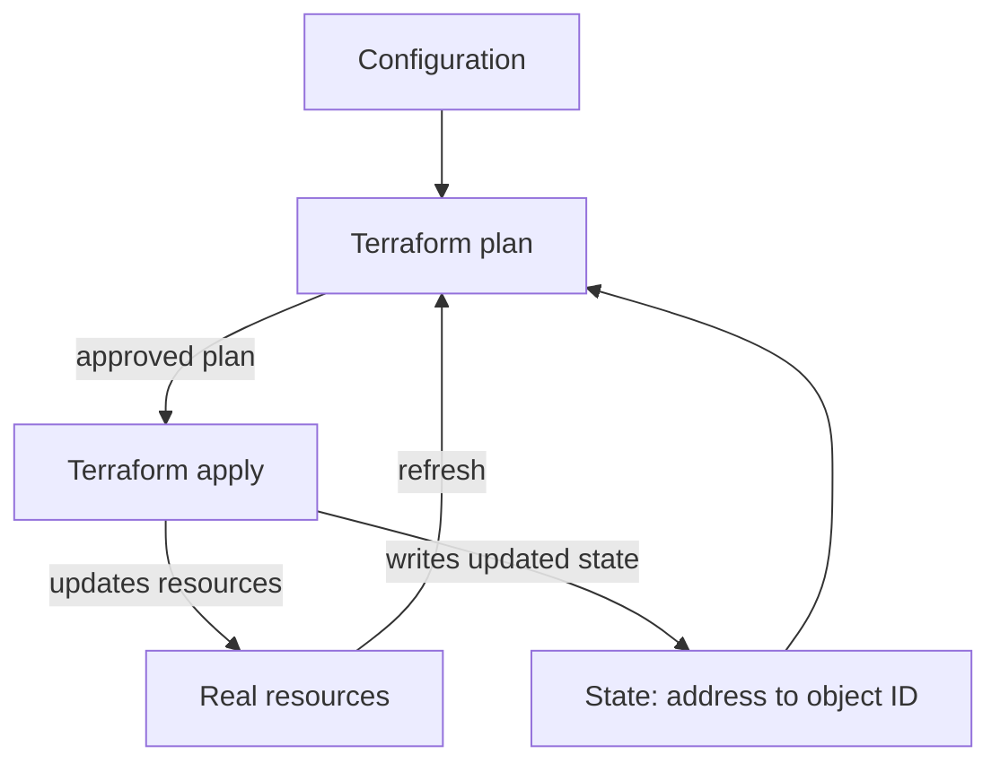
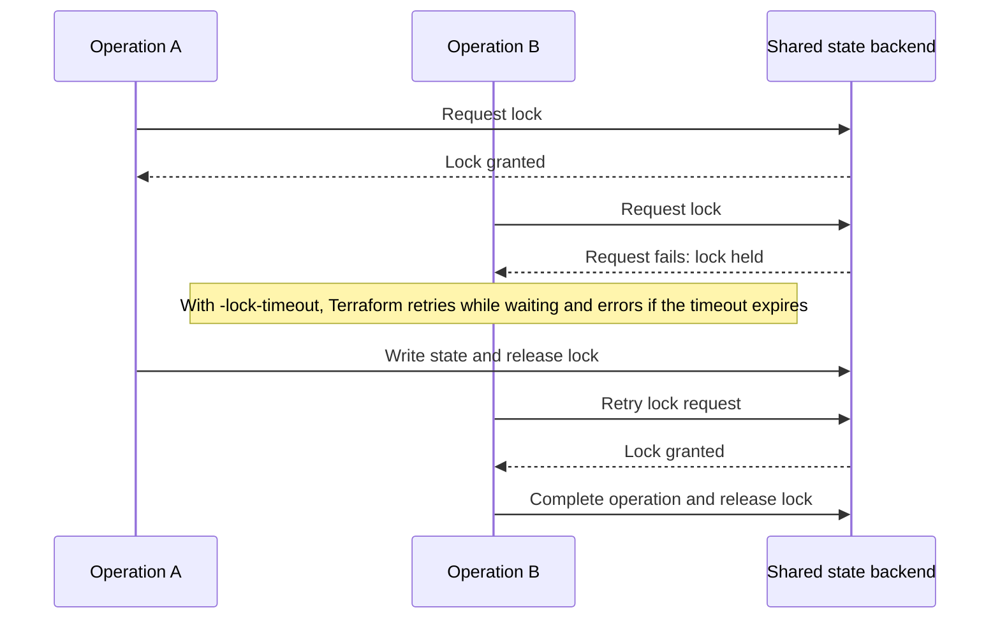
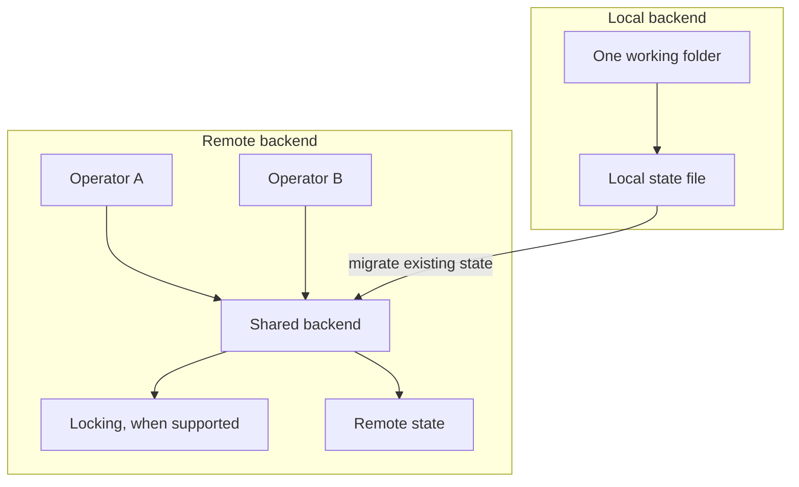

# Terraform 02 — State and drift

Prerequisite: [Terraform 01 — Terraform workflow](01-workflow.md).

## Why

Terraform state connects configuration to real resources. A lost state file can make a team lose track of ownership and recreate resources. A locked state can stop planned work until someone resolves the operation that holds the lock. State can contain secrets, so a leaked state file can expose client credentials. Parallel applies can race, overwrite state, or produce changes that no one reviewed.

Start this slice in a new folder: `submissions/terraform/02-state/`.
Copy the previous slice's `code/` folder into it and extend that work. The
previous slice's Task 04 leaves its resources present. After you capture that
task's evidence, clean up the resources from the original working folder and
state. Task 01 in this slice then recreates them with a new working state.

Use the local AWS target at `localhost:4566`. Use fictitious test values only. Keep the configuration and state that the next slice will need.
Follow the [Terraform evidence guidance](../../grading.md#terraform-evidence-without-duplicate-logs).

## Concepts

- state
- remote backend
- locking
- drift
- import
- moved blocks
- state commands

## Diagrams

### Configuration, state, and real resources



### State locking



### Local and remote backends



## Warm-ups

Create each small artifact in
`submissions/terraform/02-state/warmup/`. Keep Warm-up evidence separate from
the graded Task evidence. Do not copy a Warm-up artifact into a Task answer.

### Warm-up for Task 02 — Plan a state migration

Use this fictional service-registry scenario: Team Cedar owns a local state
file at `local-file: ./registry/state.json`. It plans to move the record to
Team Maple's test-only backend location `test-backend: catalog/registry.tfstate`.
Use only this scenario. Do not configure a real backend.

**Starter:** `submissions/terraform/02-state/warmup/task-02.md`

```markdown
# Backend migration note

- Current owner and location: [fill in]
- Target owner and location: [fill in]
- Migration risks: [fill in]
- Checks that ownership stays intact: [fill in]
```

#### Done when

- The note identifies both locations and who owns each.
- The risk field names at least two migration risks.
- The final field lists checks that would show the same objects remain tracked.

#### Evidence

- Save the completed migration note at the Starter path.

### Warm-up for Task 03 — Map a locking timeline

Complete a timeline for two teams updating one shared release manifest. Do not
configure Terraform. Team Atlas starts an update before Team Birch starts its
own update to the same manifest.

**Starter:** `submissions/terraform/02-state/warmup/task-03.md`

```markdown
# Shared manifest timeline

| Step | Team or system | Event | What the other team observes |
|---|---|---|---|
| 1 | [fill in] | [fill in] | [fill in] |
| 2 | [fill in] | [fill in] | [fill in] |
| 3 | [fill in] | [fill in] | [fill in] |
| 4 | [fill in] | [fill in] | [fill in] |
- Check after the lock clears: [fill in]
```

#### Done when

- Each row identifies an actor and an event.
- Each row describes what the other team observes.
- The timeline distinguishes the operation that holds the lock from the
  operation that cannot proceed.
- The final check confirms that later work can read the shared manifest.

#### Evidence

- Save the completed timeline at the Starter path.

### Warm-up for Task 04 — Review a feature-flag change

Review a fictional feature flag that someone changed by hand. The declared
value is `checkout-banner = off`; the hand-edited value is `checkout-banner = on`.

**Starter:** `submissions/terraform/02-state/warmup/task-04.md`

```markdown
# Feature-flag drift review

| View | Flag value or decision |
|---|---|
| Declared value | [fill in] |
| Value changed by hand | [fill in] |
| Team decision: keep or undo | [fill in] |
| Change needed for a clean next plan | [fill in] |
```

#### Done when

- The table records the declared and manually changed values.
- The decision explains whether the manual change should remain.
- The last row states what must change to make the next plan reflect that
  decision.

#### Evidence

- Save the completed review at the Starter path.

### Warm-up for Task 05 — Plan a DNS-record import

Plan how to bring the existing fictional DNS record `status.example.test`,
type `TXT`, value `ready`, under management without recreating it.

**Starter:** `submissions/terraform/02-state/warmup/task-05.md`

```markdown
# Existing DNS record

- Existing record identity: [fill in]
- Proposed Terraform address: [fill in]
- Import evidence to collect: [fill in]
- Plan check for duplicate creation: [fill in]
```

#### Done when

- The identity distinguishes the existing record from other records.
- The proposed address identifies one managed object.
- The evidence and plan check would show that Terraform adopts, rather than
  duplicates, the record.

#### Evidence

- Save the completed import plan at the Starter path.

### Warm-up for Task 06 — Rename an ownership-ledger entry

Map a renamed report entry for the fictional artifact `quarterly-report` in an
ownership ledger. Choose old and new ledger addresses for that same artifact.

**Starter:** `submissions/terraform/02-state/warmup/task-06.md`

```markdown
# Ownership-ledger rename

- Old ledger address: [fill in]
- New ledger address: [fill in]
- Evidence both addresses refer to one artifact: [fill in]
- Plan outcome that would concern you: [fill in]
```

#### Done when

- The old and new addresses differ.
- The evidence connects both addresses to the same artifact.
- The last field describes an outcome that would show a replacement risk.

#### Evidence

- Save the completed rename note at the Starter path.

### Warm-up for Task 07 — Trace a fictional key in state

Trace the fictional API key field through this generic state record. Its value
is redacted and is not a credential.

**Starter:** `submissions/terraform/02-state/warmup/task-07.md`

```json
{
  "resources": [
    {
      "type": "example_service",
      "name": "demo",
      "instances": [
        {
          "attributes": {
            "id": "demo-id",
            "api_key": "[REDACTED FICTIONAL VALUE]"
          }
        }
      ]
    }
  ]
}
```

```markdown
# Redacted state trace

- State path containing the value: [fill in]
- Fields to redact from evidence: [fill in]
- What a sensitive marker changes: [fill in]
- Access risk that remains: [fill in]
```

#### Done when

- The path identifies where the value appears without writing the value itself.
- The redaction field covers sensitive content in both values and metadata.
- The final fields distinguish display protection from state access control.

#### Evidence

- Save the completed trace at the Starter path with all values redacted.

## Tasks

### Task 01 — Continue the previous slice

Copy the previous slice's code into `submissions/terraform/02-state/code/` and recreate its local resources in the local AWS target. Extend the configuration in this new folder.
Continue with the S3 bucket and text object from Terraform 01.

#### Constraints

- Work only in `submissions/terraform/02-state/code/`.
- Use the local AWS target. Do not use a real AWS account or real credentials.
- Start from the previous slice's code. Do not copy a finished solution.
- Use fictitious values for names, tokens, and other test data.

#### Done when

- The copied configuration initializes successfully in the new folder.
- The resources from the previous slice exist in the local AWS target again.
- The new folder has its own working state.
- The configuration remains ready for the state exercises that follow.

#### Evidence to produce

- The copied and extended configuration files and `.terraform.lock.hcl`.
- A safe state inspection and a local AWS check of the recreated resources.
- The working folder and state location.

### Task 02 — Move state to a remote backend

Move the working state to a remote backend provided by the local AWS target. Keep the same managed resources.

Look at the [S3 backend](https://developer.hashicorp.com/terraform/language/backend/s3).
It needs a bucket for state storage, separate from the bucket used in the exercises.
Keep that backend bucket's lifecycle independent of the resources whose state it stores.
Check locking support in both the backend and the local AWS target.

#### Constraints

- Use a remote backend in the local AWS environment.
- Do not use a real cloud account or store real credentials.
- Migrate the existing state. Do not discard it and create a new empty state.
- Keep backend access restricted to the test setup.

#### Done when

- Terraform initializes with the remote backend.
- The existing resources remain tracked after migration.
- A remote state object exists in the backend.
- A state inspection proves that the remote state contains the managed resources.

#### Evidence to produce

- The backend configuration.
- Migration output.
- The remote backend object or a safe inspection of it.
- A state inspection that does not expose secret values.

### Task 03 — Observe state locking

Use two concurrent Terraform operations against the same remote state. Make the second operation encounter the lock held by the first.

#### Constraints

- Use the same working folder and remote state as Task 02.
- Do not unlock state while another operation is still running.
- Do not delete, edit, or replace the lock record by hand.
- Use only local AWS resources and fictitious values.

#### Done when

- One operation holds the remote state lock.
- A second operation reports that the state is locked.
- The first operation completes without corrupting state.
- A later state inspection succeeds after the lock clears.

#### Evidence to produce

- Output that identifies the lock holder or lock metadata.
- Output from the blocked operation.
- Completion output from the first operation.
- A post-lock state inspection.

### Task 04 — Create and repair drift

Change a managed resource directly in the local AWS target, outside Terraform. Use Terraform to detect and reconcile the drift.
Bucket tags or object contents give you a small, reversible attribute to investigate.

#### Constraints

- Change one meaningful, reversible attribute.
- Make the manual change only in the local AWS target. Do not edit the state file.
- Do not use real client data.
- Record the manual change before Terraform checks the resource.

#### Done when

- A Terraform plan identifies the manual change.
- The plan shows the intended correction.
- Applying the plan restores the declared configuration.
- A local AWS check confirms the corrected value.

#### Evidence to produce

- The recorded manual change.
- The plan that detects the drift.
- A local AWS check of the corrected resource.

### Task 05 — Import a hand-made resource

Create one supported resource directly in the local AWS target. Add matching Terraform configuration and bring the existing resource under management.
A second S3 bucket is one option. Choose a resource with a documented import identifier.

#### Constraints

- Create the resource outside Terraform.
- Use a resource that the configured provider and local AWS target support.
- Do not delete and recreate the hand-made resource to claim the import.
- Use fictitious test values.

#### Done when

- The hand-made resource exists before Terraform manages it.
- Terraform state tracks that existing resource after the import.
- A plan does not propose creating a second copy.
- The configuration matches the imported resource closely enough for a clean follow-up plan.

#### Evidence to produce

- The hand-made resource and its identifier.
- The configuration added for it.
- Import output and a state inspection.
- The follow-up plan.

### Task 06 — Rename a resource without replacement

Rename one Terraform resource address while keeping the underlying local AWS resource.

#### Constraints

- Rename a resource that Terraform already manages.
- Use the repository's Terraform version.
- Do not destroy the resource before or during the rename.
- Review the plan before applying it.

#### Done when

- The configuration uses the new resource address.
- The plan records an address move without destroy and create actions.
- Applying the change keeps the same local AWS resource.
- State uses the new address after the apply.

#### Evidence to produce

- The configuration before and after the rename.
- The plan showing the address move.
- A state and local AWS check showing the same resource remains.

### Task 07 — Find a secret in state

Put a fictitious secret-like test value into a managed configuration, then find where Terraform stores it in state. Redact the value in all evidence.
The existing text object can hold the test value. You do not need a real credential or another service.

#### Constraints

- Use a made-up value that has no access to a real system.
- Do not use real credentials, tokens, or personal data.
- Do not paste the secret into evidence, answers, logs, or commits.
- Keep access to the state and backend limited to the local test setup.

#### Done when

- You identify the state path or attribute that contains the test value.
- You show that marking a value sensitive does not remove it from state.
- Evidence contains only a redacted value.
- The final configuration and state remain usable for the next slice.

#### Evidence to produce

- The test configuration with the value redacted.
- A redacted state inspection that identifies the value's location.
- A short note about the access risk.
- A final check that the working state remains available.

## Predict the plan

These ungraded exercises use fictional resources. Predict the plan before you
write your reasoning. Do not run Terraform for these scenarios.

### Out-of-band drift

A declared bucket tag is `owner = "platform"`. Someone changes the live tag to
`owner = "release"` without changing configuration.

#### Constraints

- Do not change the scenario values.
- Describe what Terraform compares before it proposes an action.
- Do not treat the exercise as evidence for Task 04.

#### Done when

- The prediction identifies whether the live value matches the declaration.
- The prediction states what action Terraform is likely to propose.
- The reasoning distinguishes configuration, state, and the live resource.

#### Evidence to produce

- A short plan prediction and the reasoning behind it.

### Rename with a moved block

A resource block changes from `aws_s3_bucket.logs` to
`aws_s3_bucket.audit_logs`. The configuration also declares a `moved` block
from the old address to the new address.

#### Constraints

- Do not apply a plan.
- Explain the purpose of the address mapping without assuming a real bucket.
- Keep this prediction separate from Task 06 evidence.

#### Done when

- The prediction describes how the address mapping affects Terraform's state
  comparison.
- It identifies the outcome that would signal an unintended replacement.
- It states what to inspect before any apply.

#### Evidence to produce

- A short plan prediction and one check that would confirm the intended move.

## Explain

Answer these questions in `submissions/terraform/02-state/answers.md`.

### Explain 1

**Situation:** A configuration marks a database password input as `sensitive`. The plan shows `(sensitive value)` instead of the password. The team stores state in a bucket that every developer can read.

**Question:** Is the password protected? Who can read it?

**A solid answer covers:**

- Where Terraform stores the password value.
- What the `sensitive` marking changes and what it does not change.
- Which controls protect state, and who they should limit.

### Explain 2

**Situation:** You rename `aws_s3_bucket.logs` to `aws_s3_bucket.audit_logs` in the configuration. You change nothing else.

**Question:** What does the next plan propose, and how do you keep the same bucket?

**A solid answer covers:**

- How Terraform connects a block in configuration to a real resource.
- Why the plan proposes that action, and the risk if you apply it.
- How you tell Terraform about the rename, and how you check the plan before you apply.

### Explain 3

**Situation:** During an incident, an on-call engineer changes a setting on a managed bucket directly in the cloud console. The next day, someone runs `terraform plan`.

**Question:** What does the plan propose, and how should the team decide what to do?

**A solid answer covers:**

- What Terraform does with a difference between configuration and the real resource.
- How the team decides whether to keep or undo the manual change.
- What the team must change in each case so the next plan is clean.
