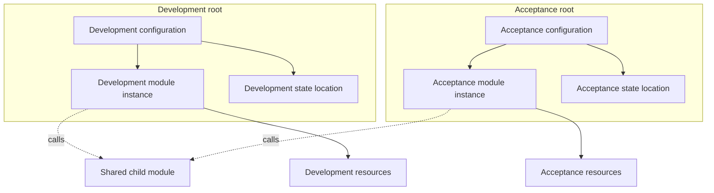

# Terraform 03 — HCL and modules

Prerequisite: [Terraform 02 — State and drift](02-state.md).

## Why

Reusable, readable Terraform is easier for a client to review, change, and
inherit. Clear interfaces make ownership visible and reduce the risk that a
small environment change affects the wrong resources.

Start this slice in a new folder: `submissions/terraform/03-modules/`.
Copy `submissions/terraform/02-state/code/` into its `code/` folder and extend that work.
Keep the local AWS resources and remote state from the previous slice
working while you add isolated environment state.

Use the local AWS target at `localhost:4566`. Use fictitious test values only. Keep the
configuration and state ready for the Terraform and Vault slice that follows.
Follow the [Terraform evidence guidance](../../grading.md#terraform-evidence-without-duplicate-logs).

## Concepts

- variables
- validation
- locals
- count versus for_each
- data sources
- modules
- environments
- test

## Diagram



Each environment has its own root configuration and its own state location.
Both roots call the same shared child module, so the resource logic exists once.
Each module instance creates resources for its own environment only.
The boundary between the two roots keeps a change in one environment out of the other.

## Tasks

### Task 01 — Build from a map

Copy the previous slice's code into `submissions/terraform/03-modules/code/`. Extend it
so one resource type is created from a map of environment-specific or
component-specific values.

S3 objects for two fictional components are one option.
Reuse the bucket from Terraform 02 rather than adding an unrelated service.

#### Constraints

- Work only in `submissions/terraform/03-modules/code/`.
- Start from the previous slice's code. Do not copy a finished solution.
- Keep the existing local AWS resources and remote state working.
- Use a map as the source for repeated resources. Do not duplicate one block
  for each map entry.
- Use only local AWS resources and fictitious values.

#### Done when

- The copied configuration initializes successfully in the new folder.
- The map describes at least two resources.
- Terraform plans and applies the resources derived from the map.
- The state and a local AWS check agree about the resources that exist.

#### Evidence to produce

- The copied and extended configuration files and `.terraform.lock.hcl`.
- The map and the resource declaration that consumes it.
- The plan for the resources derived from the map.
- A local AWS check and state inspection for the created resources.

### Task 02 — Validate inputs and select a repetition method

Add input validation and local values to the configuration. Use either
`count` or `for_each` where it fits, and record why that choice matches the
identity of the resources.

#### Constraints

- Keep the resources from Task 01 manageable.
- Validate at least one input at the module or root configuration boundary.
- Use locals for a repeated derived value instead of repeating its expression.
- Do not hide invalid test input by changing it before validation.
- Use fictitious values and keep the work local to the local AWS target.

#### Done when

- A valid input produces a successful plan.
- An invalid input is rejected before resource creation.
- A local value is used by a resource or module input.
- The chosen repetition method keeps resource identity stable when one item
  changes.

#### Evidence to produce

- The variable declaration, validation rule, and local values.
- A successful check with valid input.
- A failed validation check with invalid input.
- A plan or state inspection showing the chosen resource addresses.
- A short note explaining the choice of `count` or `for_each`.

### Task 03 — Read an existing resource

Use a data source to read an existing resource or service in the local AWS
environment. Use the result in the configuration without taking ownership of
the existing object.

An existing S3 bucket is a suitable lookup target.
Keep its ownership separate from the resources that use the lookup result.

#### Constraints

- The object must exist before the data source reads it.
- Do not create the object with the resource block under test.
- Do not import the object into state for this task.
- Use a read-only data source supported by the configured provider and local AWS target.
- Use fictitious test values only.

#### Done when

- The data source reads the existing object successfully.
- A plan or output shows that the read value is available to configuration.
- Terraform does not plan to create or destroy the object read by the data
  source.
- The configuration uses the read value in a managed resource or module input.

#### Evidence to produce

- The data source configuration and the object it reads.
- Plan output for the read.
- A safe output or state inspection showing the consumed value without
  exposing secrets.
- A local AWS check that distinguishes the existing object from managed objects.

### Warm-up for Task 04 — Sketch a report-format interface

Choose two fictional report formats and sketch their interface. Do not define
cloud or file resources.

Keep this Warm-up evidence in `submissions/terraform/03-modules/warmup/`,
separate from the graded Task evidence. Do not copy it into a Task answer.

**Starter:** `submissions/terraform/03-modules/warmup/task-04.md`

```markdown
# Report-format interface

- Input supplied by each caller: [fill in]
- Result each caller needs: [fill in]
- Responsibility kept inside the shared module: [fill in]

| Caller   | Input contract | Result used by caller |
| -------- | -------------- | --------------------- |
| Format A | [fill in]      | [fill in]             |
| Format B | [fill in]      | [fill in]             |
```

#### Done when

- The input and result describe a clear module boundary.
- The module responsibility does not duplicate caller-specific work.
- Both callers have distinct, valid contracts.

#### Evidence

- Save the completed interface sketch at the Starter path.

### Task 04 — Turn the configuration into a module

Move the reusable resource logic into a child module with a small, clear
interface. Call the module twice with different inputs.

A bucket with its text object is a small resource group to package together.
Choose what callers supply and which identifiers they need back.

#### Constraints

- Keep provider configuration and environment-specific values outside the
  child module unless the provider requires otherwise.
- Define the module inputs and outputs explicitly.
- Do not duplicate the module's resource logic at the call sites.
- Use two distinct module instances with different valid inputs.
- Preserve the working local resources and remote state.

#### Done when

- Terraform initializes the root configuration and the child module.
- Both module instances appear in the plan with distinct addresses.
- Applying the configuration creates both module instances in the local AWS target.
- A module output is consumed by the root configuration or recorded in state.
- A change to one module input does not require copying the module logic.

#### Evidence to produce

- The child module files and its input and output declarations.
- The root module calls and their distinct inputs.
- The plan for both module instances.
- State and local AWS checks for both module instances.
- A safe inspection showing the module output was consumed.

### Task 05 — Isolate environment state

Represent at least two environments with separate state locations. Keep the
resources from the prior tasks available while proving that an environment
change cannot silently use the other environment's state.

Development and test are enough. Keep names distinct in the shared local AWS target,
not just in Terraform state.

#### Constraints

- Use separate state locations for the environments.
- Do not use one shared state file for both environments.
- Do not treat workspaces as the only production isolation boundary.
- Keep each environment's values explicit and reviewable.
- Use only local AWS resources and fictitious values.

#### Done when

- Each environment initializes against its own state location.
- A state inspection shows distinct managed resource addresses or values for
  the environments.
- A plan in one environment does not propose changes to the other
  environment's resources.
- The existing remote state and local AWS resources remain usable.

#### Evidence to produce

- The environment layout and state configuration.
- State inspections that identify the separate state locations without
  exposing secrets.
- Plans for both environments and a local AWS check of their distinct resources.

### Task 06 — Test the module

Write one Terraform test for the child module. The test must check a useful
module behavior without relying on a real cloud account.

#### Constraints

- Keep the test with the module or its test configuration in
  `submissions/terraform/03-modules/code/`.
- Test a behavior introduced by the module, not only Terraform syntax.
- Use local provider behavior or supported test doubles.
- Do not use real credentials, client data, or a real cloud account.
- Keep the test repeatable and safe to run more than once.

#### Done when

- The Terraform test file is discovered by the repository's Terraform
  version.
- The test runs successfully against the module.
- At least one assertion checks a module result or contract.
- The test does not alter the other environment's state.

#### Evidence to produce

- The Terraform test file and the module behavior it checks.
- Test discovery and successful test output.
- The assertion result, with secrets and tokens redacted.
- A note identifying which environment state the test used.

## Explain

Answer these questions in `submissions/terraform/03-modules/answers.md`.

### Explain 1

**Situation:** You create three buckets with `count` from the list `["dev", "test", "prod"]`. Later, you remove `"dev"` from the list.

**Question:** What does the plan propose for the `test` and `prod` buckets? How would `for_each` change that?

**A solid answer covers:**

- How `count` and `for_each` each identify resource instances.
- Why removing one item affects the other instances with `count`.
- When `count` is still a good choice.

### Explain 2

**Situation:** A child module returns a connection string that includes a sensitive password. Terraform reports an error at the root output. A teammate wraps the value in `nonsensitive()` to stop the error. The password now appears in the CI log.

**Question:** What was the sensitive marking protecting, and what did the teammate's change expose?

**A solid answer covers:**

- How Terraform tracks sensitive values as they pass between modules and outputs.
- Where sensitive values stay visible even before the teammate's change.
- A safer way to give the caller what it needs.

### Explain 3

**Situation:** A team keeps development and production in one folder with one backend. They switch between them with `terraform workspace select`. An engineer tests a change in `dev` and forgets to switch back before the next apply.

**Question:** What can go wrong, and why are separate state locations a stronger boundary?

**A solid answer covers:**

- What workspaces share: code, backend, and credentials.
- What a mistake in workspace selection can do to production.
- What separate state locations add, such as access control and visible environment values.

## Predict the plan: change a map key

A `for_each` resource has type `terraform_data` and name `artifact`:

```terraform
resource "terraform_data" "artifact" {
  for_each = {
    api    = "blue"
    worker = "green"
  }

  input = each.value
}
```

Its original instances use the addresses
`terraform_data.artifact["api"]` and `terraform_data.artifact["worker"]`.
The next configuration renames the `api` key to `service` and keeps both
values unchanged. Predict the plan actions for the affected instances.

### Constraints

- Do not run Terraform for this scenario.
- Keep both map values unchanged.
- Keep this prediction separate from Task 01 evidence.

### Done when

- The prediction identifies which instance identity changed.
- It states what action Terraform is likely to propose for that instance.
- It explains why unchanged map values do not, by themselves, preserve a
  changed key's identity.

### Evidence to produce

- A short plan prediction with the relevant old and new addresses.
