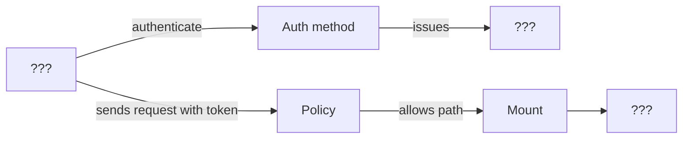

# Vault 00 — Diagram preview

This is a working copy for Task 01 in
[Vault 00 — Foundations](00-foundations.md). Run `mise run serve`, open this
page in the local site, and edit the Mermaid source below. MkDocs will render
your changes as you save the file.

When the diagram is complete, copy the entire Mermaid block to
`submissions/vault/00-foundations/diagram.md`. Keep that submitted file for
grading; this preview page is not the submission.

