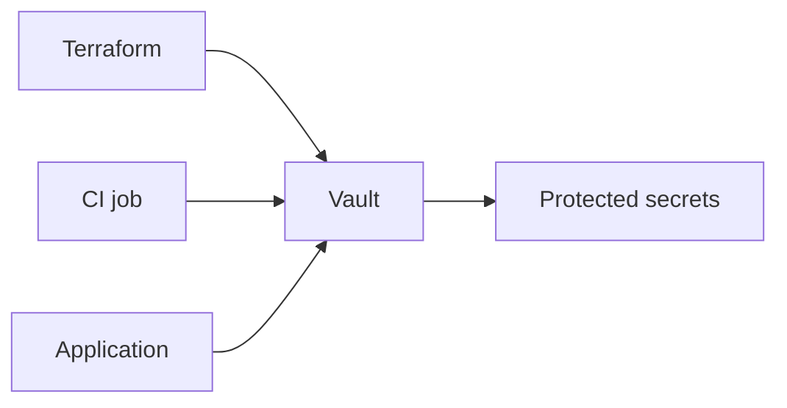
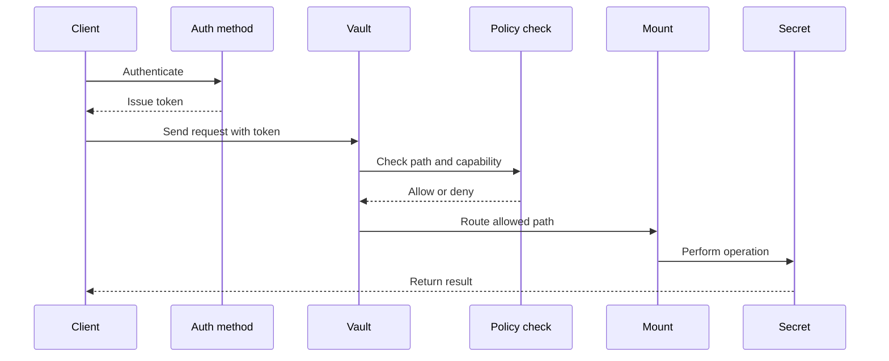
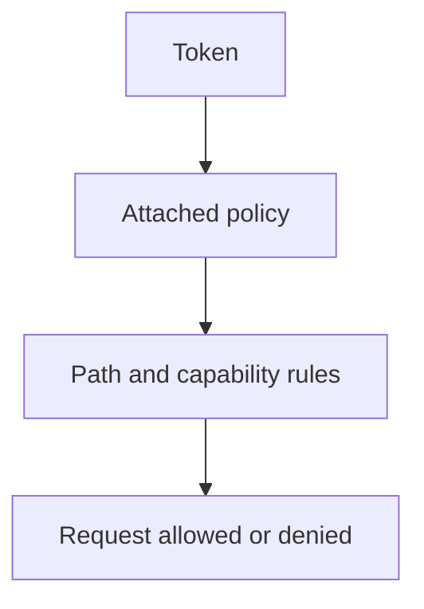
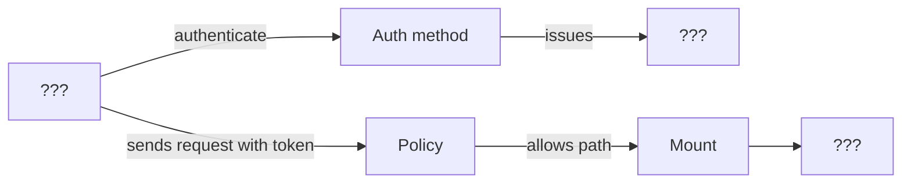

# Vault 00 — Foundations

Prerequisite: None.

## Why

Vault sits between clients and sensitive values. A client authenticates, sends
a request with a token, and Vault checks the token's policy before routing the
request to the mount that owns the path. This model explains Vault without
requiring a running server.

This slice needs no Vault server, cloud account, or repository Compose setup.
Use the [Vault 00 diagram preview](00-foundations-preview.md) while editing:
run `mise run serve`, open the preview page in the site, and edit that Markdown
file. When it is complete, copy its Mermaid block to
`submissions/vault/00-foundations/diagram.md`. Keep that submitted source for
grading; the preview page is only a working copy.

## Concepts

### The Vault request model

- A **path** names a Vault operation. It is a logical API path, not necessarily
  a filesystem path.
- A **mount** is a secrets engine mounted under a path prefix. The mount
  receives requests for that prefix and implements the operation.
- A **policy** grants capabilities on path patterns. Vault denies a request
  unless the attached policies allow the requested capability.
- A **token** is a credential used for requests. It carries policy attachments
  and other metadata; it is not the secret being protected.
- An **auth method** verifies a client's identity and issues a token. It
  authenticates the client; the token's policies authorize later requests.

### Where Vault sits

### How a request flows

### How tokens and policies relate

## Tasks

### Task 01 — Complete a Vault request diagram

Edit the scaffold in the [Vault 00 diagram preview](00-foundations-preview.md)
and replace every `???` with a clear label. Copy the completed Mermaid block to
`submissions/vault/00-foundations/diagram.md`. The submitted Markdown source can
be checked without a Vault server.

#### Constraints

- Keep the submitted diagram in `submissions/vault/00-foundations/`.
- Use one Mermaid diagram in `diagram.md`.
- Replace every `???` with a label that matches the Vault model.
- Do not add a Vault server, cloud setup, tokens, or real secrets.
- Keep the completed source readable and renderable as Mermaid.

#### Done when

- `diagram.md` contains one Mermaid diagram and no `???` placeholders.
- The diagram names a client, auth method, token, policy, mount, and secret.
- The arrows show authentication before the token request reaches the policy
  and mount.

#### Evidence to produce

- The completed `submissions/vault/00-foundations/diagram.md` source.
- A short note identifying the source lines that show the six required nodes and
  the request flow.

## Explain

Answer these questions in
`submissions/vault/00-foundations/answers.md`.

### Explain 1

What does an auth method do, and how is its job different from the policy check
that follows?

### Explain 2

A request targets `secret/data/app`. Which part of that path tells Vault which
mount receives the request, and which path does the policy need to match?

### Explain 3

Why can a token allow a client to request a secret without being the secret
itself?
