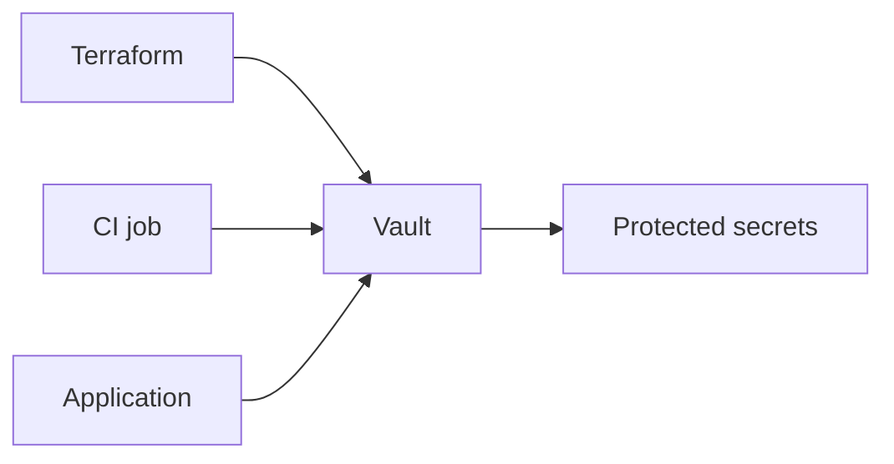
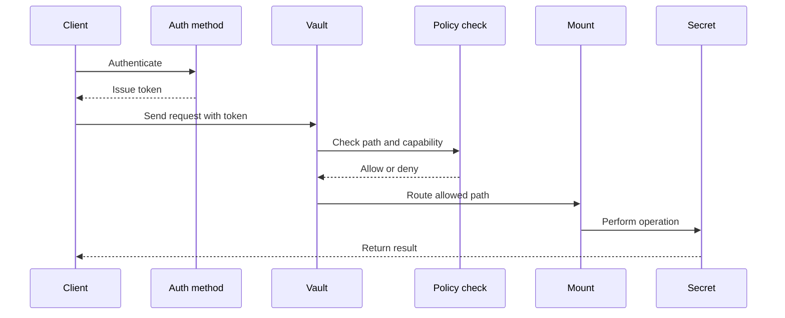
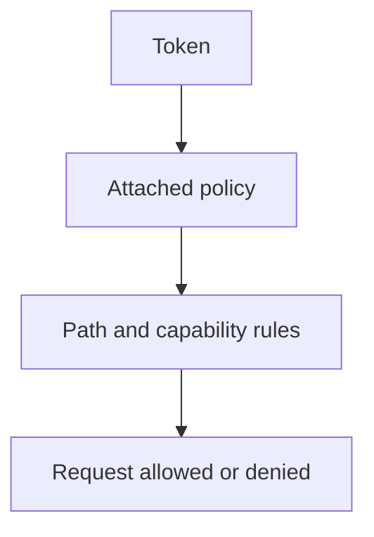
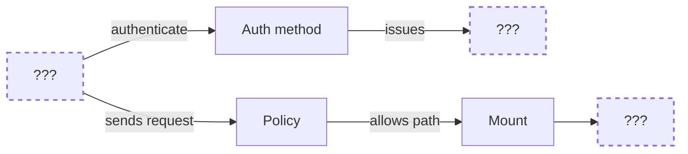

# Vault 00 — Foundations

Prerequisite: None.

## Why

Vault sits between clients and sensitive values. A client authenticates, sends
a request with a token, and Vault checks the token's policy before routing the
request to the mount that owns the path. This model explains Vault without
requiring a running server.

This slice needs no Vault server, cloud account, or repository Compose setup.
Edit [`submissions/vault/00-foundations/diagram.md`](00-foundations-preview.md)
while `mise run serve` runs. The site renders that file, so you see changes as
you save. It is the file graded for this slice.

## Concepts

### The Vault request model

- A **path** names a Vault operation. It is a logical API path, not necessarily
  a filesystem path.
- A **mount** is a secrets engine mounted under a path prefix. The mount
  receives requests for that prefix and implements the operation.
- A **policy** grants capabilities on path patterns. Vault denies a request
  unless the attached policies allow the requested capability.
- A **token** is a credential used for requests. It carries policy attachments
  and other metadata; it is not the secret being protected.
- An **auth method** verifies a client's identity and issues a token. It
  authenticates the client; the token's policies authorize later requests.

### Where Vault sits

### How a request flows

### How tokens and policies relate

## Tasks

### Task 01 — Complete a Vault request diagram

Edit the scaffold in
[`submissions/vault/00-foundations/diagram.md`](00-foundations-preview.md) and
replace every `???` with a clear label. The Markdown source can be checked
without a Vault server.

#### Constraints

- Keep the submitted diagram in `submissions/vault/00-foundations/`.
- Use one Mermaid diagram in `diagram.md`.
- Replace every `???` with a label that matches the Vault model.
- Do not add a Vault server, cloud setup, tokens, or real secrets.
- Keep the completed source readable and renderable as Mermaid.

#### Done when

- `diagram.md` contains one Mermaid diagram and no `???` placeholders.
- The diagram labels all six nodes with Vault terms that match the request flow.
- The arrows show authentication before the request reaches the policy and
  mount.

#### Evidence to produce

- The completed `submissions/vault/00-foundations/diagram.md` source.
- A short note identifying the source lines that show the six required nodes and
  the request flow.

## Explain

Answer these questions in `submissions/vault/00-foundations/answers.md`.

### Explain 1

**Situation:** An application logs in to Vault and receives a token. Its next request, a read of `secret/data/payments`, gets `permission denied`.

**Question:** Did the login fail? Which step denied the request, and what do you check first?

**A solid answer covers:**

- What the auth method decided, and what it did not decide.
- Which check denied the read.
- What you inspect to find the cause.

### Explain 2

**Situation:** A KV version 2 secrets engine is mounted at `secret/`. A policy grants `read` on `secret/app`. A client runs `vault kv get secret/app` and gets `permission denied`.

**Question:** Why is the request denied, and which path must the policy match?

**A solid answer covers:**

- Which part of the request path selects the mount.
- The full API path that the request uses.
- Why the CLI command and the policy path look different.

### Explain 3

**Situation:** A Vault token appears in a CI log. A teammate says: "No problem. The token is not the database password."

**Question:** Is the teammate right? What can someone do with the leaked token?

**A solid answer covers:**

- What a token is and how Vault uses it.
- What decides the damage a leaked token can do.
- What limits that damage, and what you do now.
