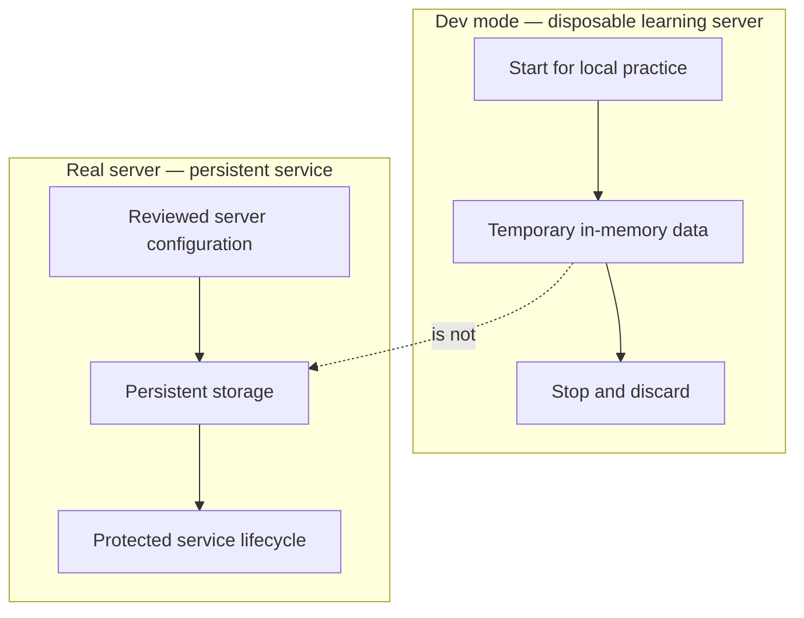
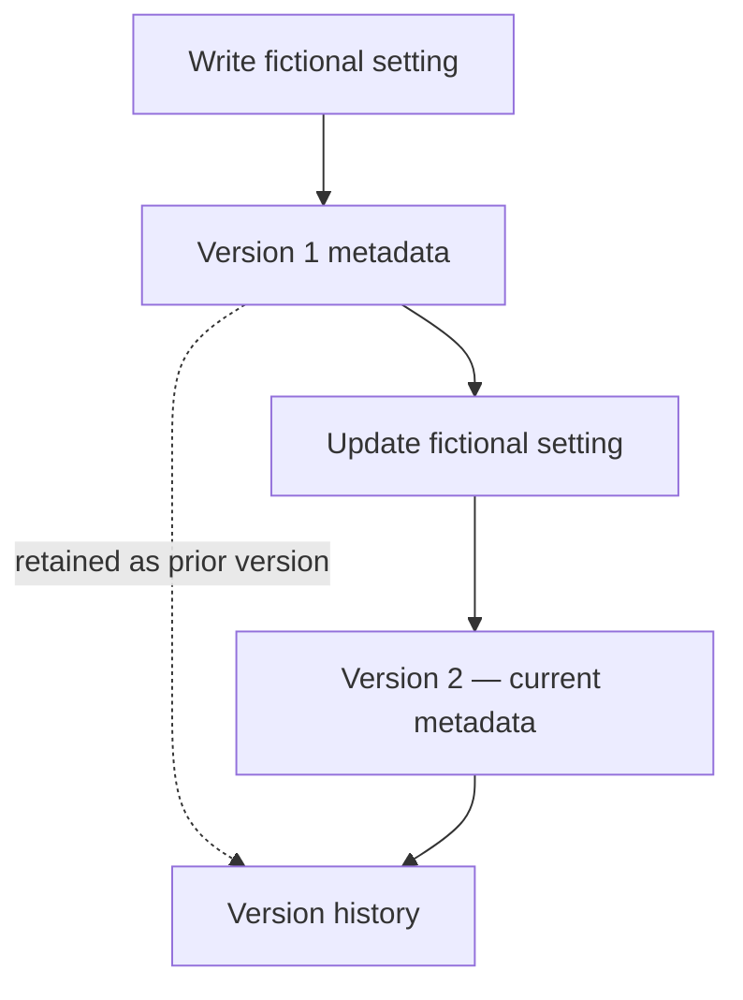

# Vault 01 — Vault first contact

## Why

Vault stores secrets outside application code and build configuration. This
reduces the chance that a password reaches source control, CI variables, logs,
or Terraform state. Vault also controls who can read a secret and records
when access should stop.

Prerequisite: [Vault 00 — Foundations](00-foundations.md).

Start this slice in a new folder: `submissions/vault/01-vault-first-contact/`.
Build the Vault dev-mode container yourself. Do not add a Vault server to the
repository Compose file. Use fictitious test values only, and redact tokens
from evidence.

## Concepts

- dev mode
- KV versions
- TTL
- revocation
- capabilities
- root token

### Dev mode and a real server



### KV v2 versions over time



## Warm-ups

Create each separate practice artifact in
`submissions/vault/01-vault-first-contact/warmup/`. Keep Warm-up evidence
separate from graded Task evidence. These are offline exercises; do not copy
their artifacts into Task answers.

### Warm-up for Task 01 — Repair a disposable service health check

Review a fictional disposable test service whose client address and health
probe disagree. Record the correction without writing a runnable Vault setup
or including a token.

**Starter:** `submissions/vault/01-vault-first-contact/warmup/task-01.md`

```markdown
# Disposable service startup manifest

| Item | Fictional value |
|---|---|
| Startup mode | [fill in] |
| Listener address | [fill in] |
| Client address | [fill in] |
| Health probe target | [fill in] |

# Disposable service readiness review

| Item | Current fictional value | Corrected value |
|---|---|---|
| Service listener address | `http://127.0.0.1:8200` | [fill in] |
| Client address | `http://127.0.0.1:8201` | [fill in] |
| Health probe target | `http://127.0.0.1:8201` | [fill in] |

- Why the client and probe must reach the listener: [fill in]
- Readiness evidence to collect, with credentials redacted: [fill in]
```

#### Done when

- The startup manifest identifies a mode and addresses consistent with the
  corrected review.
- The corrected listener, client, and health-probe addresses agree.
- The review explains why the client and probe must reach the listener.
- The note identifies safe readiness evidence and excludes credentials.
- The review remains a written exercise, not a server configuration.

#### Evidence

- Save the completed review at the Starter path.

### Warm-up for Task 02 — Track fictional setting versions

Build a version timeline for the fictional feature setting `banner = "blue"`,
updated to `banner = "green"`. Record metadata only, not setting values in
evidence.

**Starter:** `submissions/vault/01-vault-first-contact/warmup/task-02.md`

```markdown
# Feature-setting mount record

| Item | Fictional value |
|---|---|
| Mount name | [fill in] |
| Engine type and version | [fill in] |
| Setting path | [fill in] |

# Feature-setting version timeline

| Version | Event | Current or prior | Safe metadata to record |
|---|---|---|---|
| 1 | [fill in] | [fill in] | [fill in] |
| 2 | [fill in] | [fill in] | [fill in] |

- Which version is current: [fill in]
- How evidence avoids disclosing setting values: [fill in]
```

#### Done when

- The mount record names the fictional mount, versioned engine, and setting path.
- The timeline records both events and distinguishes the earlier version from
  the current version.
- The evidence describes version metadata without reproducing either value.
- The completed artifact is saved at the Starter path.

#### Evidence

- Save the completed timeline at the Starter path.

### Warm-up for Task 03 — Review document-metadata access

Complete an offline access matrix for a fictional non-root token that may read
document metadata at one path but must not read its sibling path.

**Starter:** `submissions/vault/01-vault-first-contact/warmup/task-03.md`

```markdown
# Document-metadata access review

- Fictional policy path: [fill in]
- Capability required for the allowed read: [fill in]
- Token lifetime limit: [fill in]

| Request path | Expected result | Why |
|---|---|---|
| `secret/metadata/handbook` | [fill in] | [fill in] |
| `secret/metadata/payroll` | [fill in] | [fill in] |
```

#### Done when

- The policy path and capability allow only the fictional handbook metadata
  read.
- The matrix allows the handbook path and explains why.
- The matrix denies the sibling payroll path and explains why.
- The token lifetime is bounded; no server or actual token is used.

#### Evidence

- Save the completed access review at the Starter path.

### Warm-up for Task 04 — Record a temporary credential retirement

Write a redacted incident timeline for retiring a fictional temporary build
credential. Do not create or include a live token.

**Starter:** `submissions/vault/01-vault-first-contact/warmup/task-04.md`

```markdown
# Temporary build credential retirement

| Stage | Event or check | Redacted evidence |
|---|---|---|
| Before retirement | [fill in] | [fill in] |
| Retirement | [fill in] | [fill in] |
| After retirement | [fill in] | [fill in] |

- Follow-up if the credential may have been used: [fill in]
```

#### Done when

- The retirement event records revocation of the fictional credential.
- The timeline distinguishes the access check before retirement from the
  denial check afterward.
- Evidence identifies the credential only through redacted metadata.
- Follow-up addresses any possible use before retirement.

#### Evidence

- Save the completed timeline at the Starter path.

## Tasks

### Task 01 — Start Vault in dev mode

Create a local Vault dev-mode setup in the new slice folder. Start the server
and confirm that a Vault client can reach it.

#### Constraints

- Work only in `submissions/vault/01-vault-first-contact/`.
- Build the Vault container and its startup configuration yourself.
- Do not use the repository Compose file for the Vault server.
- Use dev mode for local learning only.
- Use fictitious test values.
- Do not commit an unredacted token.

#### Done when

- The new folder contains the files needed to start the Vault dev server.
- The server starts and stays healthy.
- A Vault client reaches the server.
- Evidence identifies the dev-mode server without exposing its token.

#### Evidence to produce

- The container and startup configuration.
- Server startup and health output.
- A redacted client check.

### Task 02 — Store and version a secret

Enable or use a KV secrets engine. Store a fictitious application secret, update
it, and inspect its version history.
Look for KV version 2, which supports the version history this task needs.
One fictional application's configuration path is enough. Reuse it for the later access tests.

#### Constraints

- Keep the work in the new slice folder.
- Use a KV engine, not a different secrets engine.
- Use a test path and fictitious values.
- Create at least two versions of the same secret.
- Do not put secret values, tokens, or client data in evidence.

#### Done when

- The KV engine is available at a documented mount.
- A test secret exists at a documented path.
- The path has at least two versions.
- The current version and an earlier version can be distinguished safely.
- Evidence redacts all secret values.

#### Evidence to produce

- The mount and test path.
- Redacted output for the current and earlier versions.
- Version metadata that shows the update.

### Task 03 — Limit a token to one read path

Write a policy that grants read access to one KV path. Create a non-root token
with that policy, then test both an allowed path and a different path.

#### Constraints

- Grant only the capability needed to read the selected path.
- Do not grant access to the whole mount.
- Use a non-root token for all access tests.
- Give the token a bounded TTL.
- Keep the root token out of files and evidence.
- Use fictitious test paths and values.

#### Done when

- The policy names exactly one allowed secret path.
- The test token has the policy and a bounded TTL.
- The token reads the allowed path.
- The same token cannot read a different path.
- Evidence shows both outcomes without exposing the token or secret value.

#### Evidence to produce

- The policy file with test paths only.
- Token metadata with the token value redacted.
- A successful allowed-path check.
- A denied different-path check.

### Task 04 — Revoke a token

Create a separate test token, prove that it works before revocation, revoke it,
and prove that Vault rejects it afterward.

#### Constraints

- Use a non-root token with a bounded TTL.
- Test the token before revocation.
- Revoke the exact test token after the first check.
- Test the same token after revocation.
- Do not use or disclose a real token.

#### Done when

- The test token works before revocation.
- Vault revokes the test token.
- The revoked token fails after revocation.
- Evidence identifies the token through redacted metadata only.

#### Evidence to produce

- Pre-revocation access output.
- Revocation output or token metadata.
- Post-revocation denial output.

## Policy allow/deny drills

These are ungraded path-reading exercises. Answer from the policy snippets;
they require no Vault server. For each request, mark **allow** or **deny** and
give the matching path and capability.

### Drill 1 — KV v2 read path

Policy:

```hcl
path "secret/data/reports/weekly" {
  capabilities = ["read"]
}
```

| Request | Allow or deny? | Matching policy path and capability |
|---|---|---|
| Read `secret/data/reports/weekly` | [fill in] | [fill in] |
| Read `secret/data/reports/monthly` | [fill in] | [fill in] |
| Write `secret/data/reports/weekly` | [fill in] | [fill in] |

#### Constraints

- Use only the literal policy path and listed capability.
- Do not assume wildcard access or capabilities not shown.
- Do not start a Vault server or include secret values.

#### Done when

- Every request is marked allow or deny using the exact path and capability.
- The answer explains why the sibling path and write request do not match.

#### Evidence

- Save the completed decision table and explanation in the slice's notes.

### Drill 2 — Metadata listing path

Policy:

```hcl
path "secret/metadata/team-a/*" {
  capabilities = ["list"]
}
```

| Request | Allow or deny? | Matching policy path and capability |
|---|---|---|
| List `secret/metadata/team-a/guide` | [fill in] | [fill in] |
| List `secret/metadata/team-b/guide` | [fill in] | [fill in] |
| Read `secret/data/team-a/guide` | [fill in] | [fill in] |

#### Constraints

- Treat `*` as matching only the remainder of the stated path pattern.
- Use only the listed `list` capability; do not infer `read`.
- Do not start a Vault server or include secret values.

#### Done when

- Each request is judged from both its path and requested capability.
- The explanation distinguishes listing metadata from reading KV data.

#### Evidence

- Save the completed decision table and explanation in the slice's notes.

## Explain

Answer these questions in `submissions/vault/01-vault-first-contact/answers.md`.

### Explain 1

**Situation:** A token has one policy. That policy grants `read` on `secret/data/app` and nothing else. The token tries to write to `secret/data/app` and to read `secret/data/billing`.

**Question:** What happens to each request, and why is Vault designed this way?

**A solid answer covers:**

- The result of each request, and the reason.
- What "deny by default" means for paths the policy does not name.
- Why deny by default is safer than allow by default when someone adds new secrets.

### Explain 2

**Situation:** You find that a token has leaked. You revoke it.

**Question:** What does revocation stop, and what can it not undo?

**A solid answer covers:**

- What happens to later requests that use the revoked token.
- What happens to secrets the attacker already read.
- What else you must do after you revoke the token.

### Explain 3

**Situation:** A small team keeps the root token from their first setup in a password manager. They use it for daily work because it is easier.

**Question:** What risks does this create, and what should the team do instead?

**A solid answer covers:**

- What the root token can do and how long it lasts.
- What the audit log can and cannot tell the team about who did what.
- A safer way to do daily work, and when root access is still needed.
