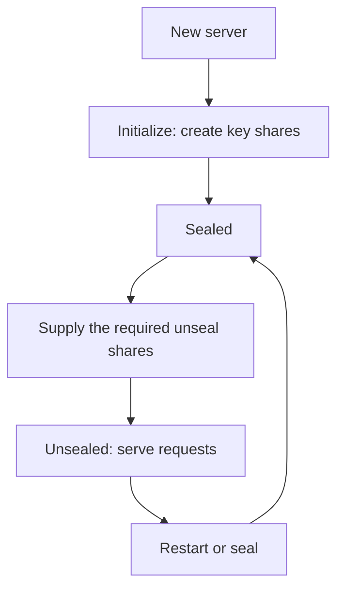
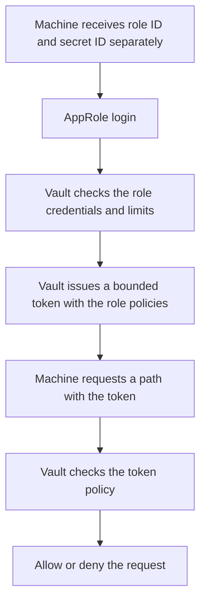
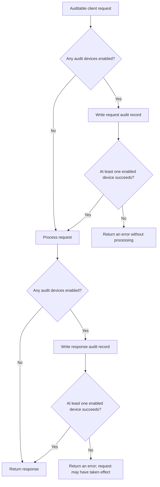

# Vault 02 — Vault as a real server

Prerequisite: [Vault 01 — Vault first contact](01-vault-first-contact.md).

## Why

Dev mode hides the work that keeps a Vault server safe and recoverable. It
uses temporary storage and convenient startup settings. Operators must own
the seal process, storage recovery, authentication choices, audit trail,
server configuration, and TLS decision.

Start this slice by copying your `submissions/vault/01-vault-first-contact/code/`
folder to `submissions/vault/02-vault-server/code/`. Extend the copied work in the
new folder. Use fictitious test values. Keep unseal shares, credentials,
tokens, and snapshots out of evidence and commits.

Keep one local Vault server with integrated storage, a persistent volume, and a
fictitious KV record. Add an AppRole, a policy, and an audit destination as the
tasks require. Reserve a separate disposable instance or data path for restore tests.

## Concepts

- seal
- unseal
- key shares
- integrated storage
- snapshots
- auth methods
- AppRole
- audit devices
- server config
- TLS

### Seal states



Initialization happens once and creates the key shares. Every start or seal
returns the server to the sealed state. The server serves requests only after
someone supplies enough unseal shares again.

### AppRole login



The role ID and secret ID arrive by separate paths. Login proves both and
returns a token with limits. The token policy, not the login, decides whether
each later request is allowed.

### Audit before reply

This flow applies to auditable requests. Vault exempts endpoints including
`sys/health` and `sys/unseal` from auditing.



Vault writes an audit record before it processes the request and again before
it replies. If no enabled device can write, Vault returns an error. A failed
response record can still follow a request that already took effect.

## Tasks

### Task 01 — Run Vault from a server configuration

Replace the dev-mode setup with a Vault server that reads a configuration
file. Use integrated storage with data on a persistent local volume.

#### Constraints

- Work only in `submissions/vault/02-vault-server/`.
- Start Vault outside the repository Compose file.
- Read the server settings from a configuration file.
- Use integrated storage and a persistent volume.
- Use a test listener and fictitious values.
- Do not commit keys, tokens, certificates, or storage data.
- Record the TLS choice and its local-learning limitation.

#### Done when

- The new folder contains the server configuration and startup files.
- Vault starts without dev mode.
- The server uses integrated storage.
- The data path survives container or process replacement.
- A client reaches the server.
- Evidence does not expose credentials or private key material.

#### Evidence to produce

- The configuration and startup files.
- Redacted startup and health output.
- The storage configuration and persistence check.
- A short note about the TLS choice.

### Warm-up for Task 02 — Plan archive recovery

Complete this offline recovery record for a fictional protected archive. Do
not include key material or commands.

#### Starter

```text
Share count and recovery threshold: [complete]
State after initialization: [complete]
State after sufficient shares: [complete]
State after restart and recovery: [complete]
Recovery evidence without shares or values: [complete]
```

#### Done when

- The share count and threshold require more than one share for recovery.
- The timeline identifies the sealed and recovered states, including after restart.
- The evidence identifies recovery without exposing shares or protected values.

#### Evidence to produce

- The completed recovery record in `submissions/vault/02-vault-server/warmup/`.

### Task 02 — Initialize, unseal, and restart the server

Initialize the server, protect the key shares, unseal it, and restart it.
Before restarting, write a fictitious test secret to the persistent server
storage. Show that the server remains recoverable without using dev mode and
that the same secret is readable after recovery.

#### Constraints

- Use a test-only initialization.
- Choose more than one key share and a threshold that requires more than one share.
- Store shares and the initial token outside the repository.
- Write a fictitious test secret before the restart.
- Never place shares, tokens, or secret values in evidence.
- Restart the server without deleting its persistent storage.
- Do not use the root token for routine checks.

#### Done when

- Vault starts sealed before unseal.
- Initialization creates the configured key shares and threshold.
- The server becomes ready after the required unseal shares are supplied.
- A non-root check works after unseal.
- The server starts sealed after restart and becomes ready after unseal again.
- The same test secret is readable after restart and unseal.

#### Evidence to produce

- Redacted initialization metadata showing the share count and threshold.
- Sealed and unsealed health results.
- Redacted restart and recovery output.
- A post-restart check that identifies the retained test path without its value.

### Task 03 — Log in as a machine with AppRole

Enable AppRole for a test machine. Give the role only the policy it needs.
Log in with the role credentials and use the resulting token for one request.

#### Constraints

- Use a dedicated test policy and role.
- Grant only the required capability and path.
- Deliver the role ID and secret ID as separate inputs.
- Set bounded uses or a bounded lifetime for the secret ID and token.
- Do not store role credentials, tokens, or secret values in the repository.
- Test both the allowed request and a denied request.

#### Done when

- AppRole is enabled and the test role has the intended policy.
- The machine receives a token through an AppRole login.
- The token can use the allowed path.
- The token cannot use a different path.
- Evidence redacts the role ID, secret ID, token, and secret values.

#### Evidence to produce

- Redacted role and policy metadata.
- A successful machine login check.
- Allowed and denied request results with sensitive fields removed.
- The configured lifetime or use limits.

### Task 04 — Enable an audit device

Enable an audit device, make a request as yourself, and find that request in
the audit log. Identify the request without exposing secret values.

#### Constraints

- Use a test audit destination that the server can write.
- Make a request after the audit device is enabled.
- Search for your own request by a safe request detail, such as its path or time.
- Redact tokens, request data, response data, and secret values.
- Record what the server does when the audit destination cannot accept a record.

#### Done when

- The audit device is enabled and its status is visible.
- A known request creates an audit record.
- The record identifies the request and its result.
- Evidence contains no token, secret, request body, or response body.
- The failure behavior is documented from an observed test or server message.

#### Evidence to produce

- Redacted audit-device status.
- The redacted client request result.
- The matching redacted audit record.
- A redacted failure test or server log, plus the observed behavior.

### Task 05 — Snapshot and restore integrated storage

Create a disposable test record, take an integrated-storage snapshot, remove
or change the record, and restore the snapshot in a safe test instance.

#### Constraints

- Use only fictitious test data.
- Keep the snapshot outside the repository.
- Record the snapshot metadata without uploading its contents.
- Use a separate test instance or disposable data path for the restore.
- Do not overwrite the working server before the restore is proven.
- Keep credentials, tokens, and secret values out of evidence.

#### Done when

- A snapshot completes and has identifiable metadata.
- The test record changes or disappears after the snapshot.
- The snapshot restores into the safe test instance.
- The restored instance contains the earlier test record.
- The original server remains available until the restore check passes.

#### Evidence to produce

- Redacted snapshot completion and metadata.
- The pre-snapshot and changed-record checks without values.
- Restore output and the post-restore record check.
- The location and handling statement for the snapshot, without its contents.

### Break it on purpose (ungraded) — Reject a bad server configuration

On a disposable test instance, introduce an invalid storage type in its server
configuration. Start the test instance and inspect the startup failure. Fix
the test configuration and check that the error is gone.

#### Constraints

- Use a separate test configuration, listener, and disposable data path.
- Do not stop, change, or overwrite the working server or its data.
- Use fictitious values and do not initialize or unseal the test instance.
- Keep credentials, keys, tokens, and secret values out of evidence.

#### Done when

- The disposable instance rejects the invalid storage type at startup.
- The corrected test configuration no longer produces that startup error.
- The working server and its data remain untouched.

#### Evidence to produce

- The invalid setting and redacted startup error.
- The corrected setting and redacted startup result.
- A note identifying the separate test listener and data path.

## Explain

Answer these questions in `submissions/vault/02-vault-server/answers.md`.

### Explain 1

**Situation:** A Vault server restarts after a host update at 03:00. After the restart, applications get errors from Vault. The unseal keys are split between three people.

**Question:** Why can Vault not serve requests after the restart, and what risk does the key split reduce?

**A solid answer covers:**

- What the sealed state protects.
- What must happen before Vault serves requests again.
- What splitting the unseal keys protects against, and what it costs in availability.

### Explain 2

**Situation:** An application keeps a long-lived Vault token in its configuration file. You move the application to AppRole login.

**Question:** What gets better, and what does the application still need to protect?

**A solid answer covers:**

- How the application gets a token with AppRole, and how long that token lives.
- Which AppRole credential is now the sensitive one.
- How that credential reaches the application, and how you limit its risk.

### Explain 3

**Situation:** Vault writes its only audit log to a file. The disk that holds the file becomes full.

**Question:** What happens to client requests, and why does Vault behave that way?

**A solid answer covers:**

- What Vault does when it cannot write an audit record.
- Why Vault chooses that behavior.
- What the operator must plan for, and one way to reduce the risk.
