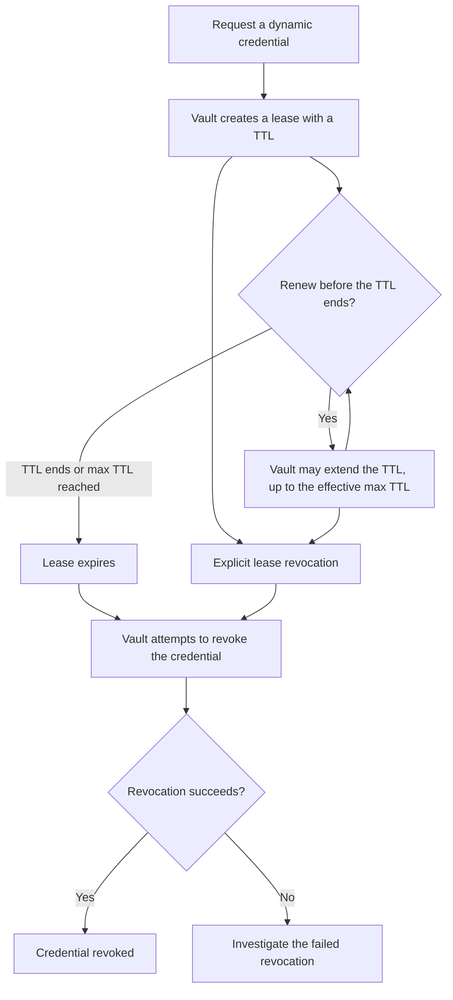
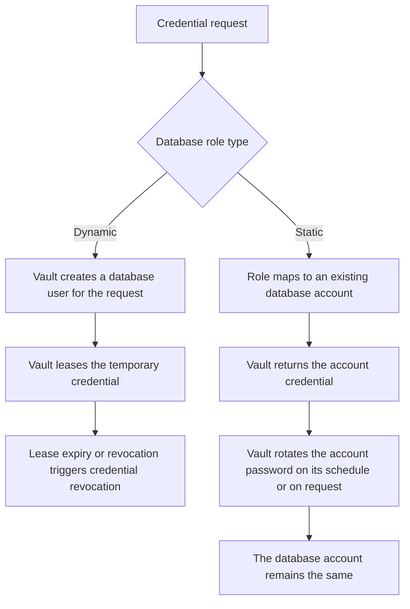

# Vault 03 — Dynamic secrets and rotation

Prerequisite: [Vault 02 — Vault as a real server](02-vault-server.md).

## Why

Static database passwords remain useful to anyone who finds them. A short-lived
credential limits the time and access an attacker gets. Vault can create a
database user for each request, track its lease, and revoke it when the work
ends.

Start this slice by copying your `submissions/vault/02-vault-server/code/` folder to
`submissions/vault/03-dynamic-secrets/code/`. Extend the copied work in the new
folder. Keep the Vault server work from the previous slice. Use fictitious test
values. Redact credentials, tokens, passwords, and secret values from evidence.

## Concepts

- lease
- renewal
- revocation
- max TTL
- database secrets engine
- dynamic role
- static role
- rotation

### Lease lifecycle



Renewal does not extend a lease beyond its effective max TTL. A failed
revocation needs investigation; expiration alone does not prove database
cleanup succeeded.

### Dynamic and static roles



## Tasks

### Warm-up for Task 01 — Compare report-job leases

Complete this offline record for two fictional report jobs. Do not request
credentials or include credential values.

#### Starter

```text
Report-job role permissions: [complete]
Job A identity and lease timeline: [complete]
Job B identity and lease timeline: [complete]
Initial TTL, renewal, and effective max TTL: [complete]
Check that the jobs use separate identities: [complete]
```

#### Done when

- The role permissions allow only the jobs' stated reporting needs.
- Both timelines show separate identities, initial TTL, renewal, and the effective max TTL.
- The identity check distinguishes the jobs without exposing credentials.

#### Evidence to produce

- The completed record in `submissions/vault/03-dynamic-secrets/warmup/report-job-leases.md`.

### Task 01 — Request database credentials on demand

Connect the Vault container to the PostgreSQL `postgres` service. Configure a
database secrets engine and a dynamic role for a test database. Request
credentials on demand twice.

Use a small fictional application dataset, such as a table of inventory items.
Choose the database permissions the application needs before defining the role.
You do not need to build an application to test database access.

#### Constraints

- Work only in `submissions/vault/03-dynamic-secrets/`.
- Extend the copied Vault server work.
- Use the repository PostgreSQL service as the test database.
- Make Vault and PostgreSQL reachable on one container network.
- Use a database secrets engine and a dynamic role.
- Set a bounded lease duration and max TTL.
- Use fictitious database names, roles, and values.
- Keep credentials and tokens outside the repository.
- Redact usernames, passwords, tokens, and secret values from evidence.

#### Done when

- Vault can reach the PostgreSQL service.
- The database secrets engine has a documented test mount.
- The dynamic role has a bounded lease and max TTL.
- The first request returns usable temporary credentials.
- The second request returns usable temporary credentials.
- The two requests have different database usernames or identities.
- Both credentials work only within their lease limits.
- Evidence contains no credential or secret value.

#### Evidence to produce

- Redacted database connection and role configuration.
- Redacted output for both credential requests.
- Lease metadata that shows separate requests and bounded lifetimes.
- A redacted check that each credential can access the test database.

### Task 02 — Revoke one lease and inspect the database

Use the two credentials from Task 01. Prove that each request created a
separate database user. Revoke one lease and prove that its database user no
longer works while the other user remains separate.

#### Constraints

- Use only the temporary credentials from Task 01.
- Identify users through safe metadata, not passwords or tokens.
- Test both users before revocation.
- Revoke exactly one lease.
- Test the revoked user after revocation.
- Check the other user separately after revocation.
- Do not delete the database or reset its data to hide a failure.
- Redact credentials, tokens, connection strings, and secret values.

#### Done when

- The database shows two separate users created by the two requests.
- Both temporary users work before revocation.
- Vault reports the selected lease as revoked.
- The revoked user's database access fails afterward.
- The other temporary user remains distinct and its result is recorded.
- Evidence shows the lease-to-user relationship without secret values.

#### Evidence to produce

- A redacted database user listing before revocation.
- Redacted pre-revocation checks for both users.
- Redacted lease revocation output.
- Redacted post-revocation checks for both users.
- A short statement that explains which user the revoked lease created.

### Warm-up for Task 03 — Analyze service-account rotation

Complete this offline rotation record for a fictional service account. Do not
include credentials or run a rotation.

#### Starter

```text
Static role and existing service-account mapping: [complete]
Rotation event: [complete]
Old credential access before and after rotation: [complete]
New credential access after rotation: [complete]
```

#### Done when

- The role maps to one existing service account, and Vault rotates its password.
- The old credential succeeds before rotation and fails afterward in a new access check.
- The new credential succeeds after rotation without changing the account identity.

#### Evidence to produce

- The completed record in `submissions/vault/03-dynamic-secrets/warmup/service-account-rotation.md`.

### Task 03 — Rotate a static database credential

Create a static role for a test database account. Request its credential, rotate
the static credential through Vault, and prove that the old credential stops
working.

#### Constraints

- Use a static role that maps to one test database account.
- Use a separate test account from the dynamic users.
- Set a bounded rotation period for the static role.
- Record the old credential only outside the repository.
- Rotate the credential through Vault.
- Test the old credential after rotation.
- Test the new credential after rotation.
- Redact both credentials, tokens, and secret values.

#### Done when

- Vault returns the static role credential before rotation.
- The old credential works before rotation.
- Vault reports a completed rotation.
- The old credential fails after rotation.
- The new credential works after rotation.
- Evidence identifies the static role without exposing its credentials.

#### Evidence to produce

- Redacted static-role configuration and metadata.
- A redacted pre-rotation access check.
- Redacted rotation output.
- Redacted checks that show old access fails and new access succeeds.

### Break it on purpose (ungraded) — Let a test lease expire

Issue a short-lived credential for a disposable database identity. Let its
lease expire, then test a new database connection and inspect the result.

#### Constraints

- Use a separate disposable role and identity, not either Task 01 identity or the static account.
- Use a bounded lease and max TTL, and do not renew or explicitly revoke the lease.
- Do not stop or reset Vault, PostgreSQL, or the working database.
- Do not change other identities or their access.
- Keep credentials, tokens, connection strings, and secret values out of evidence.

#### Done when

- The disposable identity connects before its lease expires.
- Vault shows that the lease expired, and a new connection with that identity fails.
- The record explains the expiry and investigates any failed revocation instead of assuming cleanup succeeded.
- The working environment remains available.

#### Evidence to produce

- Redacted lease lifetime metadata and pre-expiry connection result.
- Redacted expiry, post-expiry connection, and working-environment checks.
- A short explanation of the result, including any revocation failure.

## Explain

Answer these questions in `submissions/vault/03-dynamic-secrets/answers.md`.

### Explain 1

**Situation:** Team A shares one strong 40-character database password between all its services and changes it once a year. Team B gets a dynamic database credential from Vault for each service, with a one-hour lease. On Monday, both teams leak a credential in a log.

**Question:** Compare what an attacker can do with each leaked credential.

**A solid answer covers:**

- How long each credential works after the leak.
- How many systems or users each credential exposes.
- How easily each team can trace and stop the misuse.

### Explain 2

**Situation:** An application gets a dynamic database credential with a one-hour TTL and a 24-hour max TTL. It renews the lease every 30 minutes.

**Question:** What happens to the credential if the application stops renewing? What happens at 24 hours, even with renewal?

**A solid answer covers:**

- What Vault does when the lease ends.
- What renewal can extend, and where it stops.
- What the application must do to keep working.

### Explain 3

**Situation:** A static role rotates the password of a database user every 24 hours. An attacker copied the current password one hour ago.

**Question:** What does the next rotation fix, and what risk stays the same?

**A solid answer covers:**

- What the attacker can do before the next rotation.
- What rotation does not change, such as the user's database permissions or existing sessions.
- Who can still read the new password, and how you limit that.
