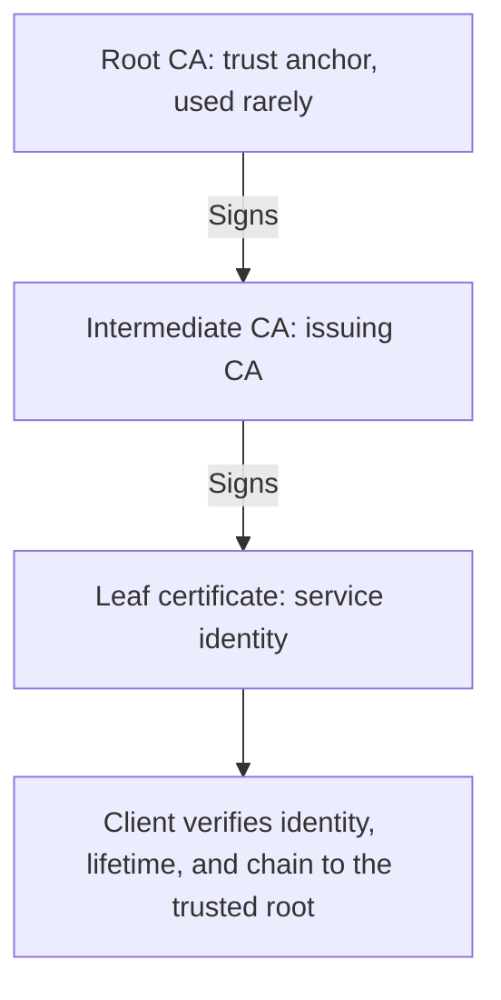
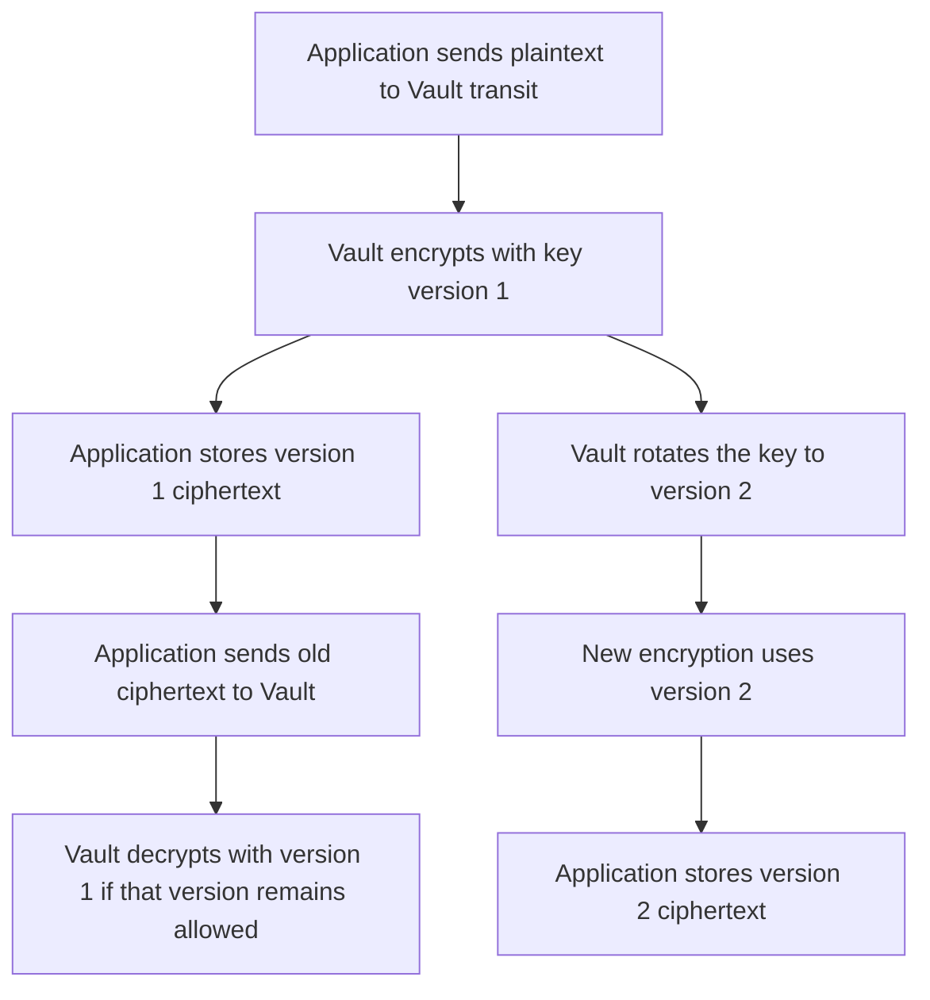
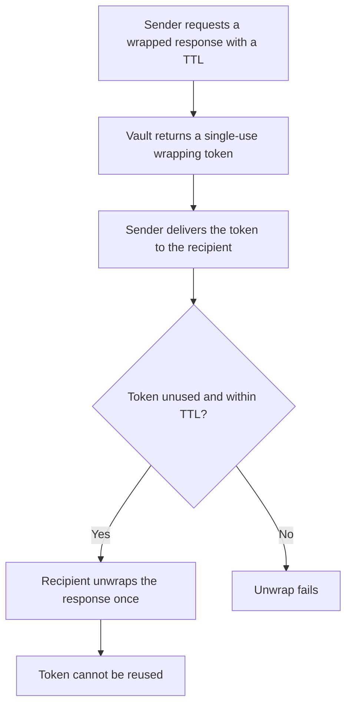

# Vault 04 — PKI and transit

Prerequisite: [Vault 03 — Dynamic secrets and rotation](03-dynamic-secrets.md).

## Why

Long-lived certificates increase the time available to an attacker after a
private key leaks. Certificate replacement also becomes costly when many
services share a long lifetime.

Applications that hold encryption keys can expose those keys through logs,
backups, memory, or a compromised host. Vault can perform encryption without
giving the application the key.

Start this slice by copying your `submissions/vault/03-dynamic-secrets/code/` folder
to `submissions/vault/04-pki-transit/code/`. Extend the copied work in the new
folder. Keep the Vault server work usable for the later integration slice. Use
fictitious test values. Redact keys, tokens, certificates, plaintext, and
secret values from evidence.

## Concepts

- root CA
- intermediate CA
- role
- certificate TTL
- revocation
- transit
- key rotation
- key versions
- response wrapping

### CA chain



The root CA signs only the intermediate CA. The intermediate CA signs the
service certificates. A client trusts a leaf certificate only when the chain
leads back to the trusted root.

Clients check revocation only if their verification setup supports and enables
it. A valid chain alone does not prove that a certificate is not revoked.

### Transit key versions



Rotation adds a new key version and does not replace the old one. New data
uses version 2, while old ciphertext still needs version 1 to decrypt.

The key stays in Vault. Blocking an old version prevents its ciphertext from
decrypting until the version is allowed again or the data is otherwise recovered.

### Response wrapping



The key decision is the check on the token. Vault unwraps the response only
for an unused token within its TTL. After one unwrap, the token is spent.

Anyone who has the wrapping token can attempt to unwrap it. Protect its
delivery and investigate an unexpected unwrap failure.

## Tasks

### Warm-up for Task 01 — Draw a metrics trust hierarchy

Complete this offline trust hierarchy for a fictional metrics endpoint. Do not
create a CA or include key material.

#### Starter

```text
Root CA role and key-handling boundary: [complete]
Intermediate CA role and key-handling boundary: [complete]
Chain from root to metrics endpoint: [complete]
Bounded issuing lifetime: [complete]
Key kept offline or used rarely and why: [complete]
```

#### Done when

- The hierarchy shows the root, intermediate, and endpoint roles and signing relationships.
- The issuing lifetime is bounded, and the key-handling boundaries distinguish the two CA keys.
- The record identifies the offline or rarely used key and explains why.

#### Evidence to produce

- The completed hierarchy in `submissions/vault/04-pki-transit/warmup/metrics-trust.md`.

### Task 01 — Build a root and intermediate CA

Create a root CA and an intermediate CA in the local Vault server. Use the
intermediate CA for service certificates.

#### Constraints

- Work only in `submissions/vault/04-pki-transit/`.
- Extend the copied Vault server work from Vault 03.
- Use a test-only root CA and intermediate CA.
- Keep the root CA separate from the issuing CA.
- Use fictitious names and values.
- Keep private keys, tokens, and certificates outside the repository.
- Redact keys, tokens, certificates, and secret values from evidence.

#### Done when

- The root CA exists and has identifiable test metadata.
- The intermediate CA exists and chains to the root CA.
- The intermediate CA can issue service certificates.
- The issuing configuration uses a bounded certificate lifetime.
- The root CA is not used as the issuing CA for service certificates.
- Evidence contains no private key or certificate value.

#### Evidence to produce

- Redacted root and intermediate CA metadata.
- Redacted chain relationship output.
- Redacted issuing configuration and lifetime metadata.
- A note that identifies where each private key is stored outside the repository.

### Task 02 — Issue a short-lived service certificate

Use the intermediate CA to issue a certificate for a fictitious service. Give
the certificate a short TTL and include the service identity it needs.

A name such as `inventory.training.test` gives the certificate a concrete identity.
You do not need a running web service for the certificate checks in this slice.

#### Constraints

- Use the intermediate CA from Task 01.
- Use a dedicated test role with a bounded TTL.
- Use a fictitious service name and test domain.
- Keep the private key outside the repository.
- Do not use a long-lived certificate to satisfy the task.
- Redact certificates, keys, tokens, and secret values from evidence.

#### Done when

- The role accepts the intended service identity.
- Vault issues a certificate from the intermediate CA.
- The certificate contains the intended subject or SAN.
- The certificate expiry shows a short lifetime.
- The certificate lifetime is shorter than the CA lifetime.
- Evidence contains no certificate or private key value.

#### Evidence to produce

- Redacted role metadata and TTL settings.
- Redacted issuance metadata.
- Certificate subject, issuer, SAN, and expiry with values minimized or masked.
- A redacted record of private-key handling.

### Task 03 — Verify the certificate chain

Verify that the service certificate chains through the intermediate CA to the
root CA. Check the service identity during verification.

#### Constraints

- Verify the certificate issued in Task 02.
- Use the complete test chain from the root and intermediate CAs.
- Check the intended service identity.
- Record a failed check when the chain or identity is wrong.
- Keep private keys, tokens, certificates, and secret values out of evidence.

#### Done when

- The complete chain verifies from the service certificate to the root CA.
- The identity check succeeds for the intended service.
- The verification identifies the intermediate issuer.
- A missing or incorrect chain or identity fails verification.
- Evidence proves the certificate chain check without exposing certificate data.

#### Evidence to produce

- Redacted successful chain-verification output.
- Redacted identity-verification output.
- A redacted failed verification result for an invalid chain or identity.
- Certificate and issuer metadata without certificate contents.

### Task 04 — Encrypt, rotate, and decrypt with transit

Use the transit engine to encrypt and decrypt a test value. Rotate the transit
key, then decrypt data created before the rotation.

One named transit key and a small fictitious text value are enough.
The test client can represent the application. You do not need a separate application build.

#### Constraints

- Use a dedicated transit key and least-privilege test policy.
- Keep the transit key inside Vault.
- Do not give the application the transit key.
- Use a fictitious test value.
- Rotate the key through Vault.
- Test old ciphertext after rotation.
- Keep keys, tokens, plaintext, ciphertext contents, and secret values out of
  evidence.

#### Done when

- The application can encrypt the test value through transit.
- The application can decrypt the encrypted value through transit.
- Vault reports a new key version after rotation.
- New encryption uses the rotated key version.
- Ciphertext created before rotation still decrypts successfully.
- Evidence identifies both key versions without exposing key or value contents.

#### Evidence to produce

- Redacted transit policy and key metadata.
- Redacted pre-rotation encryption and decryption checks.
- Redacted rotation output showing key versions.
- A redacted check that old ciphertext still decrypts after rotation.
- A redacted check that new encryption uses the rotated version.

### Task 05 — Hand over a secret with response wrapping

Use response wrapping to hand a test secret to a separate recipient. Prove
that the recipient can unwrap it once and that the wrapping token has a
bounded lifetime.

#### Constraints

- Use a fictitious test secret.
- Set a short wrapping TTL.
- Deliver only the wrapped response to the recipient.
- Keep the wrapping token outside the repository and evidence.
- Do not expose the secret value in evidence.
- Test reuse or expiry behavior without resetting the result.

#### Done when

- Vault returns a wrapped response for the test secret.
- The recipient unwraps the response successfully.
- The wrapping token has a documented bounded TTL.
- The same wrapping token cannot unwrap the response a second time.
- Evidence contains no wrapping token or secret value.

#### Evidence to produce

- Redacted wrapped-response metadata and TTL.
- A redacted recipient unwrap result.
- A redacted second-use or expiry failure.
- A note describing how the wrapped response reached the recipient without
  exposing the token.

## Explain

Answer these questions in `submissions/vault/04-pki-transit/answers.md`.

### Explain 1

**Situation:** Two designs issue service certificates. In design A, the root CA signs every service certificate. In design B, the root CA signs an intermediate CA, and the intermediate signs service certificates. In both designs, an attacker steals the key that signs service certificates.

**Question:** Compare the damage and the recovery in each design.

**A solid answer covers:**

- What the attacker can do with the stolen key.
- What the team must replace or revoke to recover in each design.
- Why the root CA should be used rarely and kept separate.

### Explain 2

**Situation:** An application stores customer ID numbers in a database. Today it encrypts them with a key from its own configuration file. You move the application to the transit secrets engine.

**Question:** What does the application no longer store, and what can an attacker still do?

**A solid answer covers:**

- Where the key lives after the change, and what the database stores.
- What an attacker gets from a database copy alone.
- What an attacker can do with the application's Vault token, and what limits it.

### Explain 3

**Situation:** You rotate a transit key from version 1 to version 2. The database holds one million rows that version 1 encrypted.

**Question:** Can the application still read the old rows? What must you do to stop relying on version 1?

**A solid answer covers:**

- Which key version encrypts new data and which decrypts old data.
- How you update old ciphertext to the new version.
- When you can block version 1, and what breaks if you block it too early.
