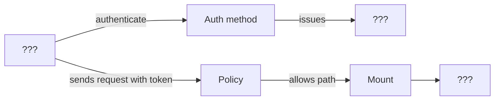

# Vault 00 — Diagram

This is the submission file for Task 01 in
[Vault 00 — Foundations](00-foundations.md). Run `mise run serve`, open this
page in the local site, and edit the Mermaid source below. MkDocs renders
your changes as you save the file.

The site shows this file from `submissions/vault/00-foundations/diagram.md`.

